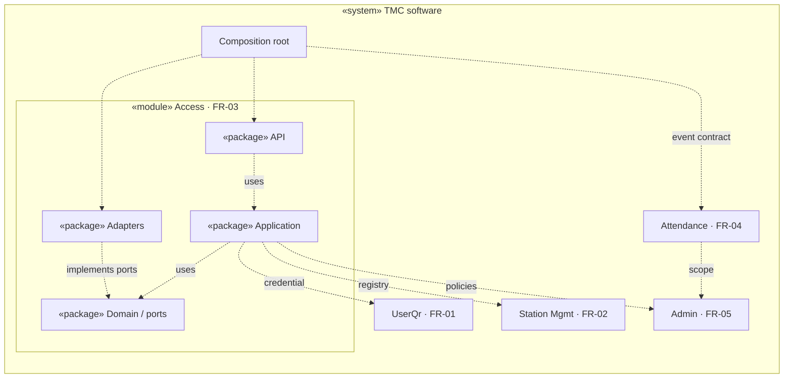
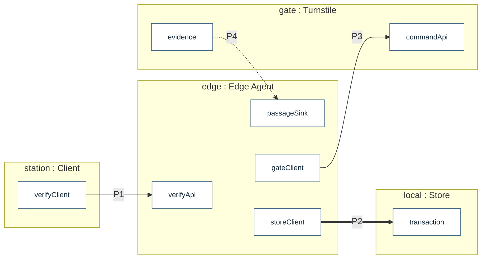
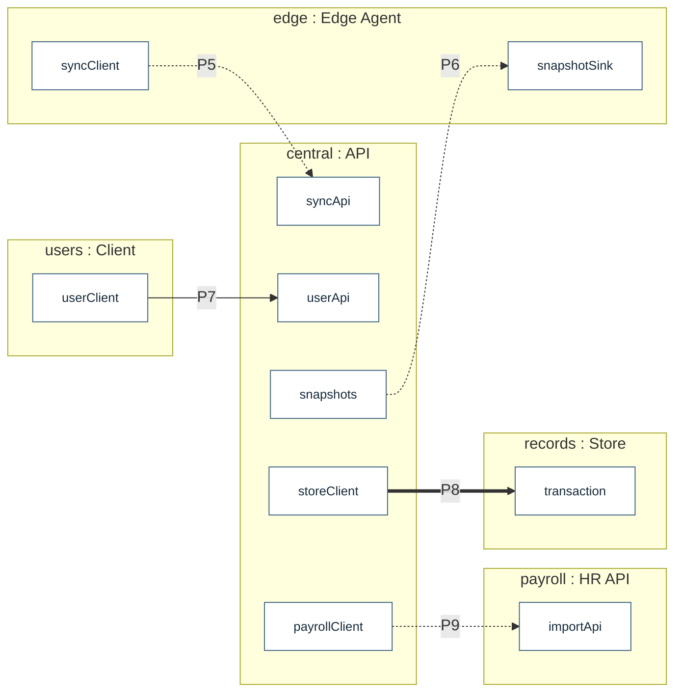
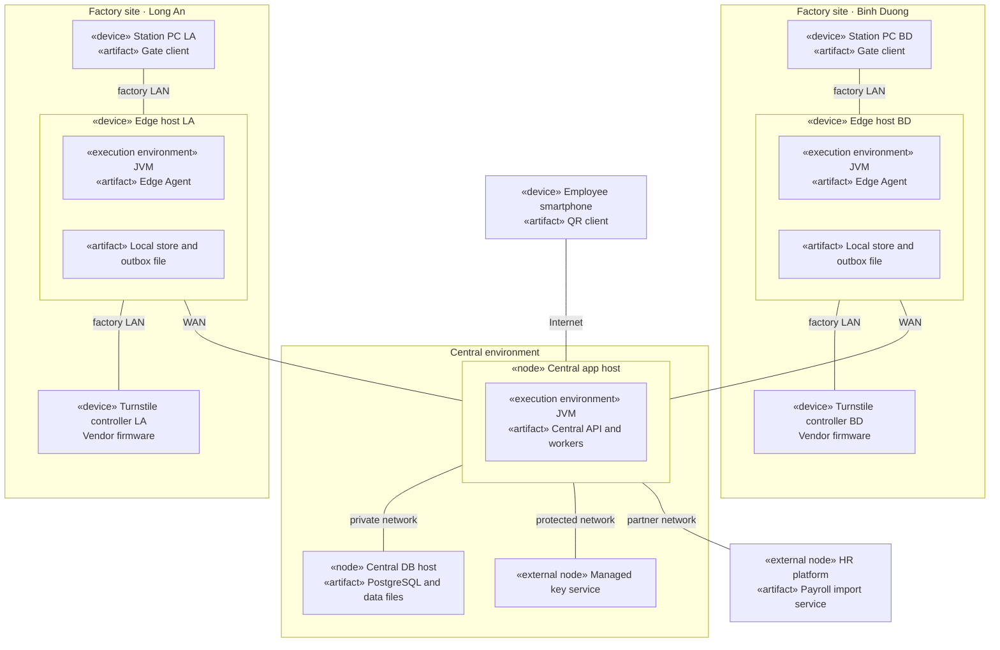
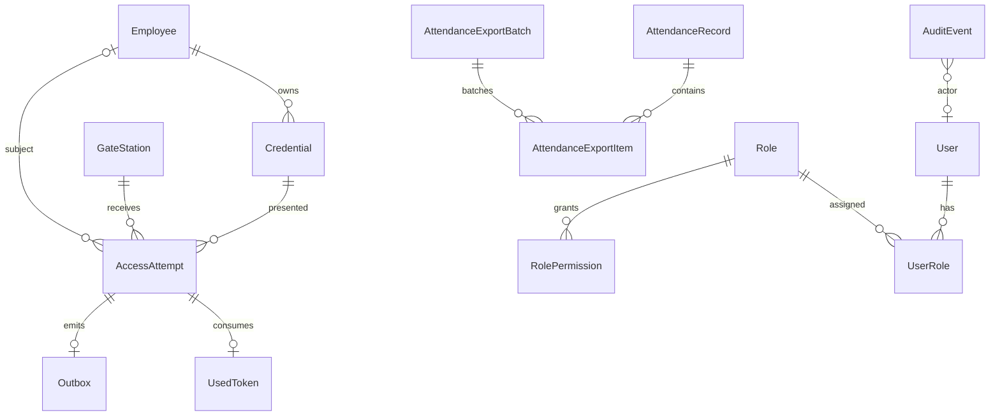
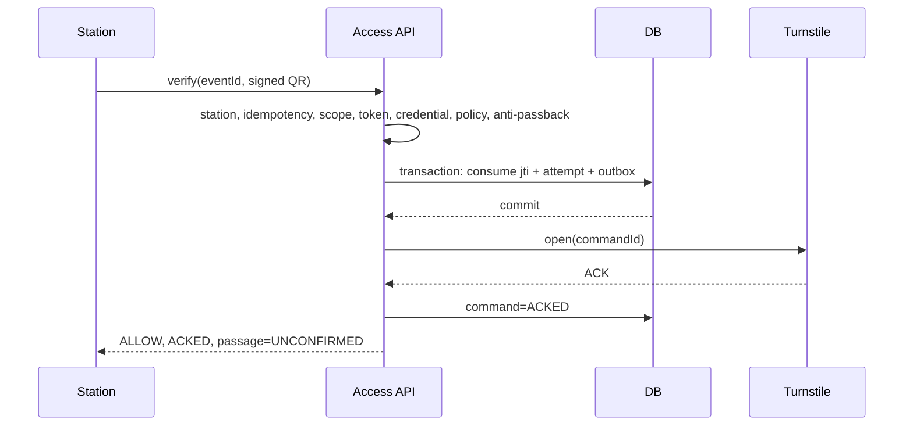
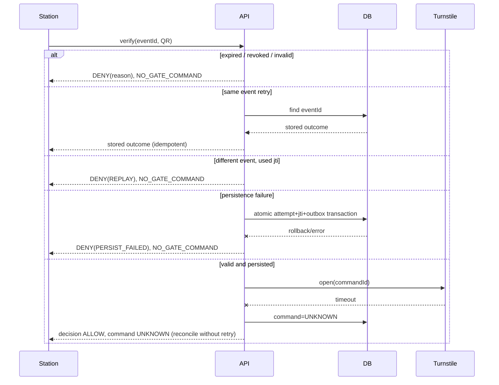
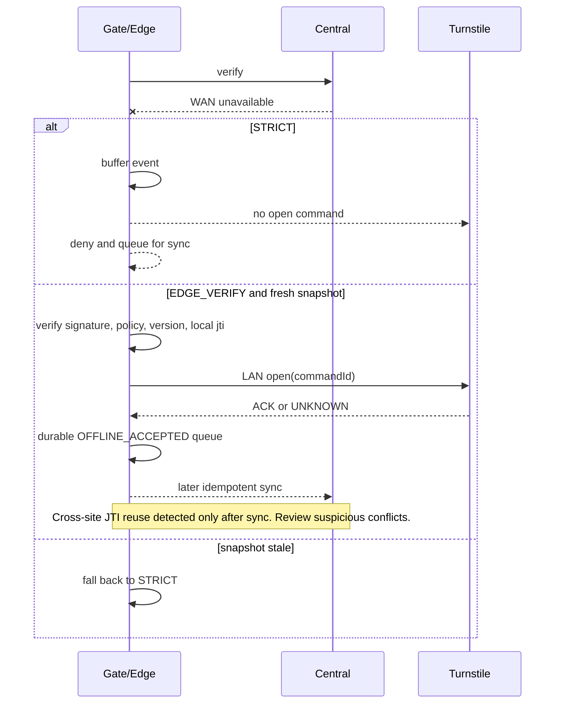
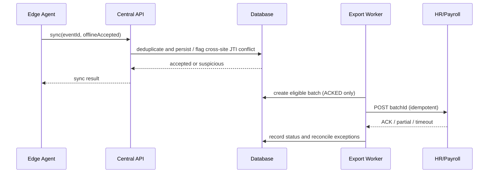

# TMC QR Attendance & Access Control

## Phase 0 — Open Questions and proposed defaults

**Status:** The defaults below are proposals for TMC review, not approved production decisions. This revision uses the supplied fixed Part I, including its FR/NFR/UC/AC/BR/CON registers and §1.5.5. UI mockup archive was also supplied. Proposed defaults remain subject to TMC/HR/Security approval.

| Open question | Proposed default pending approval | Confirmation owner |
|---|---|---|
| Is there a gate passage sensor and callback/API? | Assume unavailable. Keep command acknowledgement and physical passage as separate evidence. | TMC Facilities / Turnstile vendor |
| Which records are eligible for attendance export? | Only `command=ACKED` is eligible. `UNKNOWN` and `FAILED` enter reconciliation and are not automatically exported. `ACK_ONLY` records carry an HR-review flag. This is an assumption pending HR approval. | HR/Payroll |
| What happens during loss of WAN? | Offer `STRICT` (deny and buffer) and `EDGE_VERIFY`; propose EDGE_VERIFY with a revocation/policy snapshot no older than 15 minutes, local durable queue, and automatic fallback to STRICT after snapshot expiry. | TMC Operations / Security Guard leads |
| What are the remaining risks of EDGE_VERIFY? | A credential revoked during the staleness window might still be accepted. Reuse of the same QR at another site may only be detected after synchronization. Mark suspicious conflicts for HR/security review; neither risk is eliminated. | TMC Operations / HR |
| Who may override offline mode? | Proposed: System Administrator performs the override, with confirmation by the Security Guard assigned to that station. Require reason, scope, expiry, audit event, and automatic expiry. TMC must approve this exception because administrators do not otherwise have default access to attendance/PII. | TMC management / Security |
| Does a phone have connectivity at the gate? | Proposed normal path assumes connectivity. Fallback: phone creates a device-bound QR signed with a non-exportable device key; edge verifies with the registered public key. Treat as a distinct offline credential flow, not a static QR. | TMC Mobile/IT / Security |
| What are the phone-key lifecycle and recovery rules? | Enroll public keys through authenticated device registration; revoke on device loss; re-enroll after key replacement. Require PIN/biometric to reveal/use QR where supported. | TMC Mobile/IT / Security |
| What are the event identity, time, and direction rules? | `eventId` is a client-generated idempotency key, unique per scan attempt; preserve device `scannedAt` and server `receivedAt` in UTC; direction is explicit `ENTRY` or `EXIT` from station configuration, never inferred from alternating scans. | TMC Operations |
| What is the gate/station inventory and scope? | Maintain a registry of site, station, gate, supported directions, controller identity, and status. Reject unknown station IDs and out-of-scope credentials. | TMC Facilities / Security |
| What exactly is measured by the ≤2s requirement? | Proposed boundary: server receipt of `/access/v1/verify` through response containing the persisted decision, including synchronous Turnstile wait, excluding phone rendering/network before receipt. Separately record scan-to-gate experience. The specified ≤2 seconds remains unchanged; confirm measurement boundary. | TMC / Course stakeholder |
| What attendance policies cover night shifts, repeated scans, and missed scans? | Preserve every decision/event; deduplicate only by event identity, not by employee/time heuristic. Keep shift attribution and correction rules configurable; missed scans go to exception review, never silently synthesized. | HR/Payroll / Operations |
| How does anti-passback reset? | Update presence on `command=ACKED` with evidence quality `ACK_ONLY`; upgrade to `CONFIRMED` if sensor evidence arrives. Provide audited HR/authorized correction for missed EXIT; never require passage sensor to reset. | Security / Operations |
| What is audit scope and retention? | Append-only audit for authentication, QR issue/revoke, policy/role/config changes, every allow/deny, overrides, exports, and PII reads. Retention duration remains configurable pending TMC/legal policy. | TMC Security / Legal |
| Where do Team and Assigned data scopes come from? | Source team/manager assignments from HR, with effective dates; assigned-site/station scope from explicit TMC assignment. Fail closed if scope data is missing/stale. | HR / Data owners |
| What are the Turnstile and HR API contracts? | Contracts remain open; define ports and fake adapters. Real adapters remain skeletons until vendor specifications, auth, idempotency, and reconciliation behavior are supplied. | Turnstile vendor / HR-IT |
| What is the monthly HR export calendar? | Proposed timezone `Asia/Ho_Chi_Minh`; complete export and reconciliation before 12:00 on day 1. Holiday/calendar behavior and escalation contact require HR confirmation. | HR/Payroll |
| What QR token cryptography and lifetime are acceptable? | Short-lived, one-use signed token; proposed TTL 30 seconds, clock skew at most 5 seconds, ES256 or EdDSA, rotating `kid`. No employee PII in the token. | TMC Security |
| What is the legal basis and retention for personal data? | Minimize fields, encrypt in transit/at rest, mask by role, configurable retention. Do not claim legal compliance until TMC/legal review. | TMC Legal / Privacy owner |

## 1. Context, goals, and scope

TMC Manufacturing operates Bình Dương (~800 employees) and Long An (~600). The system controls employee access using QR credentials and records entry/exit attendance events. It integrates with existing Turnstile controllers and exports attendance to HR/Payroll; payroll calculation and visitor management are out of scope. Peak input is approximately 800 transactions per 30 minutes per factory (about 0.44 transactions/second/factory on average). The kiosk response target is **≤2 seconds** under that workload; this is a requirement, not a measured production result.

### Actors

| Actor | Main responsibility |
|---|---|
| Employee | Obtain and present own QR credential; view own permitted records |
| Production Supervisor | Review team attendance within assigned scope |
| HR Staff | Reconcile attendance exceptions and export batches |
| Security Guard | Operate assigned station and confirm authorized offline override |
| System Administrator | Configure stations, policies, integrations, and roles; does not receive default attendance/PII read permission |
| Executive Management | View approved summary reports |
| Turnstile / HR systems | External systems controlled through adapters |

### Requirement baseline

The assignment and fixed Part I specify user/QR management, gate station management, attendance recording, reporting/auditing, and system administration. Non-functional goals are ≤2 seconds at the stated workload, no attendance loss in normal operation, RBAC with comprehensive audit, and protection of personal data. The source distinguishes official requirement groups from derived and proposed sub-requirements; this report preserves that distinction.

### Quality attributes and success measures

| Characteristic | Success criterion / architectural response |
|---|---|
| Reliability and data integrity | Persist access decision, attempt, consumed `jti`, and outbox record atomically; durable queues; idempotent processing; reconciliation of unknown outcomes. No loss in normal operation. |
| Performance (time behavior) | Meet ≤2 seconds at the defined workload and agreed measurement boundary; fast-path controller call with bounded timeout, indexed persistence, and load testing before production claims. |
| Security (authenticity, accountability, nonrepudiation) | Short-lived signed QR, device binding, mTLS station identity, request replay protection, least privilege, append-only tamper-evident audit. Residual QR sharing risk remains. |
| Interoperability | Ports and replaceable adapters for Turnstile and HR; versioned APIs; explicit idempotency and partial/unknown outcomes. Real contracts remain open. |
| Maintainability and testability | Modular monolith, dependency rule, small interfaces, ordered verification steps, fake adapters, deterministic clock and ID providers. |

**Not selected as primary characteristics:** scalability is currently modest and bounded by the stated two-site workload; availability is handled as a reliability concern and explicitly qualified by offline mode; usability and portability are relevant but lack measurable targets in the supplied brief. They can be elevated when stakeholders define acceptance criteria.

## 2. Architecture structure and creation process

### 2.1 Style comparison and selection

| Style | Fit and trade-off |
|---|---|
| Layered only | Familiar separation, but cross-cutting verification and integrations can become tangled; weaker module ownership and extension points. |
| Pipeline | Excellent for ordered access verification and skip-on-failure behavior, but too narrow to organize the whole system. Use inside Access. |
| Microkernel | Fits pluggable Turnstile/HR adapters and optional verification rules, but a full plugin host adds lifecycle/versioning complexity. Use the pattern selectively at adapter boundaries. |
| Service-based | Could split modules into deployable services, but adds network failure, deployment, and data-consistency costs without current scale or team need. |
| Microservices | Independent scaling/deployment is possible, but atomic `jti` + attempt + outbox becomes cross-service work and observability/operations grow substantially. The eight fallacies are: network is reliable; latency is zero; bandwidth is infinite; network is secure; topology never changes; there is one administrator; transport cost is zero; network is homogeneous. No service split is justified yet. |
| **Selected: layered modular monolith** | One deployment and database transaction boundary; explicit Access, UserQr, Attendance modules. Layers are API → Application → Domain ← Infrastructure. Domain is framework/DB/HTTP free. It keeps deployment simple while module boundaries support later extraction if evidence warrants it. |

### 2.2 Logical architecture construction steps

1. Establish context, actors, scope, requirement IDs, and measurable quality scenarios.
2. Separate core responsibilities into Access, UserQr, Attendance, and shared cross-cutting services.
3. Define module contracts and ownership: Access decides and records attempts; UserQr issues/revokes credentials; Attendance evaluates eligibility and exports records.
4. Place business invariants in framework-independent domain types and policies.
5. Define application use cases and ordered `VerificationStep` pipeline; each failed step stops later steps.
6. Define ports for persistence, signing/validation, clock, audit, gate command, passage evidence, outbox, and export.
7. Implement infrastructure adapters (JPA/JDBC, Turnstile, HR, key store) without allowing dependencies inward.
8. Add transactional boundaries, idempotency, failure handling, RBAC/scope resolution, audit, and observability.
9. Verify with unit, contract, architecture, integration, fault-injection, RBAC, and load tests; report measured results honestly.

### 2.3 Physical architecture construction steps

1. Map runtime elements to employee phones, Gate Station scanners, per-site Edge Agent, central application, PostgreSQL, and external Turnstile/HR.
2. Assign each trust boundary and credential: OIDC/JWT for users, mTLS plus signed/timestamped requests for stations, managed signing keys centrally. Device-signed offline QR is documented as an ADR option only, not Phase 2 code scope.
3. Place edge policy/revocation snapshots, presence state and durable queue locally; bound snapshot age and define STRICT fallback.
4. Place transactionally consistent attempt, used-token, audit/outbox data in PostgreSQL; use backups and recovery procedures to support durability.
5. Expose versioned HTTPS APIs centrally; use LAN adapter to control the Turnstile; use asynchronous outbox delivery for recovery/reconciliation.
6. Deploy HR export worker separately from kiosk request path and schedule it to finish before the agreed day-1 deadline.
7. Instrument request latency, queue age, unknown commands, sync conflicts, and export status; confirm capacity through load and fault tests.

## 3. Architecture decisions (ADR index)

Each ADR below records a proposed decision, alternatives, and trade-offs. These are design proposals and remain subject to stakeholder approval where an open question applies.

| ADR | Proposal | Alternatives and trade-offs |
|---|---|---|
| ADR-01 Modular monolith | Layered modular monolith with Access, UserQr, Attendance. | Pure layers blur ownership; microservices add distributed transactions/operations; service-based split can be reconsidered with scale/team evidence. |
| ADR-02 Verification pipeline | Access uses ordered `VerificationStep`s; new steps register with explicit order; first failure skips all later steps. | One large verifier is simpler initially but violates SRP/OCP and is harder to test. |
| ADR-03 Integration adapters | Turnstile and HR use ports/adapters with fake implementations; real adapters await contracts. | Direct vendor calls couple domain/application to undocumented protocols. Plugin-like adapter selection costs configuration but enables replacement and test simulation. |
| ADR-04 Transactional outbox | Persist `AccessAttempt`, used-token consumption, state, and outbox row in one DB transaction. | Direct publish risks lost event after commit; distributed transaction is unavailable/undesirable. Outbox may deliver at least once, so consumers are idempotent. |
| ADR-05 Edge operation | Gate Station always calls its local Edge Agent; Edge is the primary verifier/controller gateway whether WAN is up or down. It uses centrally signed snapshots and syncs asynchronously; stale (>15-minute proposed bound) snapshot means STRICT. | Central-per-scan would add WAN dependency and latency and fail the stated outage objective. Always-local verification improves latency/continuity but accepts bounded policy/revocation staleness and cross-site duplicate exposure until sync. |
| ADR-06 Offline override | Proposed System Administrator action with assigned Security Guard confirmation, reason, station/site scope, audit, and expiry. TMC must approve this exception because Admin has no default attendance/PII read access. | Security-only or automatic override were considered; explicit two-person confirmation improves accountability but adds operational friction. |
| ADR-07 Mobile QR connectivity | Normal phone flow assumes connectivity. Device-signed offline QR is an ADR-described fallback only, verified by Edge against an enrolled public key; excluded from Phase 2 code scope. | Static offline QR is simpler but replayable; challenge-response is stronger but requires phone/edge protocol and time. Device signing reduces forgery but does not prevent coercion or every screenshot/replay scenario. |
| ADR-08 Attendance evidence | Keep decision, command, and passage independent. Proposed export eligibility requires `command=ACKED`; `ACK_ONLY` is flagged for HR; UNKNOWN/FAILED go to reconciliation and are not auto-exported. | Passage-only eligibility is impossible where sensor is absent; ACK does not prove passage. HR policy approval is required. |
| ADR-09 Security QR | Short-lived one-use signed token with `iss,aud,sub=credentialId,jti,iat,nbf,exp,cver,did,kid`; proposed 30s TTL, ≤5s skew, ES256/EdDSA, key rotation. | Long-lived/static QR is usable offline but easy to share/replay. Short TTL, device binding, biometric/PIN and non-exportable keys reduce risk but do not eliminate screen capture or phone lending. |
| ADR-10 API and station identity | User OIDC/JWT; station mTLS plus request signature and timestamp; `Idempotency-Key=eventId`, correlation/station headers; rate limit by station and credential. | Shared station secrets are operationally easier but offer weaker identity and rotation/audit. |
| ADR-11 RBAC and data scope | Separate permission policy from scope resolver strategies (Own, Team, Assigned, Authorized, Summary). Admin does not gain attendance/PII by virtue of configuration role. | Role-only checks miss row-level access; explicit scope costs policy/data-source work. |
| ADR-12 Audit and privacy | Append-only audit with hash chain or equivalent tamper-evidence; minimize and mask PII; encrypt in transit/at rest; retention configurable pending legal review. | Mutable logs are simpler but weaker for accountability. No claim of legal compliance until review. |
| ADR-13 HR export | Idempotent batch by `batchId`, separate worker, ACK/partial/unknown states, reconciliation; target before 12:00 day 1, timezone proposed `Asia/Ho_Chi_Minh`. | Synchronous kiosk export would couple gate availability to HR; batch isolation adds operational reconciliation. Holiday calendar is open. |
| ADR-14 Characteristics | Prioritize reliability/data integrity, performance, security, interoperability, maintainability/testability. | Other qualities await measurable stakeholder scenarios; avoid unsupported claims. |

## 4. Module view

### 4.1 Primary presentation

**MV-2 · Decomposition and uses, design proposal.** Boxes denote implementation units. Containment means `is-part-of`. A dashed arrow points from a unit that **depends on** a declaration to the unit that owns that declaration. The picture uses the box-and-line notation in Chapter 6, slides 17 and 27–30. It describes source structure and includes planned modules.

### 4.2 Element catalog and interfaces

| Element | Responsibility | Main interfaces / constraints |
|---|---|---|
| API layer | Validate transport shape/authentication and map errors; no business policy. | `POST /access/v1/verify`, QR, edge, attendance, reports, audit endpoints. |
| Station Management (FR-02) | Register site/station/gate mapping, approved configuration and assigned station health. | System Administrator manages config; Security Guard sees assigned status; availability/heartbeat shown only if hardware supplies it. |
| Reporting/Auditing (FR-04) | Attendance queries, monthly report, export batches, audit trail. | Separate AttendanceRecord store; no direct AccessAttempt table reads. |
| System Administration (FR-05) | Role/permission and allowlisted system configuration. | No default attendance/PII read; prevent self-escalation; audit every privileged change. |
| Application layer | Orchestrate use cases, transaction boundary, pipeline, idempotency and outbox. | Depends on narrow ports; no vendor SDK calls. |
| Domain layer | Invariants, state transitions, policy decisions and value objects. | No Spring/JPA/HTTP imports or annotations; no direct system clock calls. |
| Infrastructure layer | DB, crypto/key access, controller/HR adapters, queue, OIDC integration. | Implements ports; fake adapters explicitly labeled simulation. |
| VerificationStep | One verification responsibility, explicit order and result. | Steps: station auth; idempotency; station scope; token signature/time/issuer/audience/key; credential status/version; policy; anti-passback; atomic JTI consume; persistence/outbox; gate command; ACK/timeout; passage evidence. |
| `TokenValidator`, `TokenSigner` | Validate and issue QR signatures. | Key rotation by `kid`; no secret hardcoding. |
| `CredentialReader`, `CredentialWriter` | Read/revoke/version credentials. | Version bump invalidates prior QR. |
| `UsedTokenStore` | Atomic one-time JTI consumption. | Same event retry returns stored result; different event with same JTI is REPLAY. |
| `PolicyEvaluator`, `PresenceTracker` | Evaluate access policy and anti-passback. | Policy and reset exceptions configurable and audited. |
| `GateCommandSender`, `PassageEvidenceListener` | Send idempotent command and separately receive passage evidence. | ACK never implies passage. Unknown timeout is reconciled, not blindly retried. |
| `AttendanceRecorder`, `EligibilityPolicy` | Record and decide eligibility based on evidence/configuration. | Proposed default: only ACKED eligible; ACK_ONLY flagged for HR. |
| `OutboxPublisher`, `AuditWriter` | Reliable asynchronous delivery and immutable accountability record. | Outbox event IDs idempotent; audit excludes QR token and unnecessary PII. |
| `ClockProvider`, `IdGenerator` | Deterministic time and IDs. | Injected into use cases/domain services. |

### 4.3 Interface specification

Core access request carries `eventId`, `correlationId`, `siteId`, `stationId`, `direction`, `scannedAt`, credential token, and station-authenticated context. Server records `receivedAt`. Response returns decision/reason, `commandState`, `passageState`, persisted event identity, and correlation ID. It never claims physical passage without `CONFIRMED` evidence.

Required fields include `employeeId` (nullable for early denial), `credentialId`, `credentialVersion`, `evidenceLevel`, `offlineAccepted`, and `exportStatus`. QR subject is credential ID, never employee PII. Error envelope: `code`, `message` (safe), `correlationId`, `retryable`, optional field errors. Reason codes include `TOKEN_EXPIRED`, `REPLAY`, `REVOKED`, `CVER_MISMATCH`, `DEVICE_MISMATCH`, `ANTI_PASSBACK`, `STATION_SCOPE`, `POLICY_DENIED`, `PERSIST_FAILED`, `STATION_AUTH_FAILED`, `NOT_YET_VALID`, and `CLOCK_SKEW`.

### 4.4 Variability and design rationale

Access defines its policy and integration ports. The composition root selects implementations and maps access results to the Attendance contract. Eligibility is a replaceable policy. Station and administration modules own the contracts used by Access in this proposal. The [implemented module view](README.md#module-view) records the package dependencies that actually exist in Phase 2.

## 5. Component-and-connector view

### 5.1 Primary presentation

**CC-2 · Runtime topology, design proposal.** Both panels refer to the same factory Edge instance. A frame names a runtime instance using `instance : type`. A small box is a port. Numbered attachments run between ports and are interpreted by the connector catalog. Solid arrows point from the caller to the callee, thick arrows identify database access, and dashed arrows follow asynchronously delivered data. See Chapter 6, slides 36–43 and 45–51.

**CC-2a · Factory scan path**

**CC-2b · Central integration**

### 5.2 Element catalog and interface behavior

| Runtime instance | Responsibility |
|---|---|
| `station`, `edge` | The station submits scans. Edge verifies, records the decision and coordinates local gate commands. |
| `local`, `gate` | The store owns local durability and the outbox. The vendor controller executes commands and may publish passage evidence. |
| `users`, `central` | Phone and operations clients use Central APIs. Central receives Edge events, distributes snapshots and prepares payroll batches. |
| `records`, `payroll` | Central data store and external HR/Payroll import service. |

The following catalog defines the connector roles used by each numbered attachment.

| ID | Initiator / producer → participant | Contract and behavior |
|---|---|---|
| P1 | Gate Client → Edge verifier | Request/response on the factory LAN. Proposed station mTLS and signed timestamped event. Response carries decision, command outcome and passage separately. |
| P2 | Edge transaction client → local store | Local transaction commits attempt, JTI, SENT intent, audit and outbox before issuing a gate command. A second transaction records the outcome. |
| P3 | Edge gate client → Turnstile command API | Synchronous LAN command with stable `commandId`. Timeout yields UNKNOWN and triggers a status query instead of a new open command. |
| P4 | Gate evidence publisher → Edge passage sink | Optional evidence notification. This source is separate from command acknowledgment. |
| P5 | Edge sync producer → Central sync consumer | Durable asynchronous delivery with event identity, possible retransmission and Central deduplication. Cross-site JTI reuse is detected after sync. |
| P6 | Central snapshot publisher → Edge snapshot consumer | Signed key, revocation and policy snapshots. The arrow indicates snapshot data direction. Edge may fetch them outside the scan request. |
| P7 | Phone or operations client → Central user API | HTTPS/OIDC for QR issuance. Role and scope checks apply to administrative, audit, reporting and attendance operations. |
| P8 | Central storage client → central store | Transactional access to Central data using module ownership and event contracts. |
| P9 | Central export producer → HR import consumer | Out-of-band idempotent batch export, with ACK/partial/unknown reconciliation subject to the HR contract. |

### 5.3 Timing, failure, and kiosk response

Proposed LAN-path budget (not a measured result): station/Edge auth and request validation 100ms; signature/credential/policy/anti-passback 150ms; local durable transaction including `SENT` and outbox 200ms; Turnstile LAN wait up to 800ms; outcome persistence (ACK or timeout) 150ms; response/rendering overhead 150ms. Total 1,550ms, leaving 450ms under NFR-01's unchanged ≤2s cap. If ACK/timeout persistence is delayed or fails, Edge must not return a false completed success; it displays “Đang xác minh trạng thái cổng — vui lòng chờ bảo vệ hỗ trợ” (status being verified; contact the guard), retains the durable event, and raises an operational alert. The 2-second boundary still requires TMC confirmation and end-to-end measurement. WAN and HR are excluded from the scan path by topology.

### 5.4 Variability and design rationale

The station always calls Edge on the scan path. Changing WAN connectivity affects P5 and P6 independently. The local verifier continues with an allowed fresh snapshot and fails closed once that snapshot is stale. P4 depends on available sensor evidence. The offline device-signed QR proposal appears in ADR-07. The [current runtime view](README.md#component-and-connector-view) shows which components are simulated in Phase 2.

## 6. Allocation view

### 6.1 Primary presentation · Deployment style

**AL-2 · Target hardware allocation, design proposal.** Site frames group physical nodes. Device/node frames contain execution environments and artifacts deployed there. Undirected associations between nodes identify communication media. Storage and CPU sizing remain to be confirmed. This follows Chapter 6, slides 52–56 and 62–64.

### 6.2 Allocation catalog, variability and rationale

| Physical node | Software allocated from the C&C view | Operational properties / variants |
|---|---|---|
| Employee smartphone | QR client and OIDC session | Connected issuance is the proposed normal path. Device-signed offline QR requires an enrolled key. |
| Gate Station PC at each site | Gate client, scanner integration and station-specific configuration | LAN access only to its site’s Edge on the scan path. The station identity and direction come from the approved registry and event contract. |
| Edge host at each site | Edge Agent JVM, verifier, adapters, snapshot, local database and durable outbox | Persistent local disk and access to the station and Turnstile LAN are required. Disk sizing, encryption and restart recovery require verification. WAN is used for sync and snapshot distribution. |
| Central app host | Central API, sync receiver, snapshot distribution and export workers | Workers can be allocated separately when deployment capacity requires it. Verify the isolation of background work from request processing. |
| Central database host | Central PostgreSQL and data volumes | Backups, restore drills, uniqueness constraints and transaction isolation require operational verification. |
| Managed key service | Signer key and rotation service | Keep key material out of source and logs. Rotation is identified by `kid`. |
| Turnstile and HR nodes | Vendor firmware and payroll import API | Their network and authentication contracts remain open. Phase 2 uses simulations. |

**Mapping across the views.** The Access implementation units in MV-2 contribute to the Edge runtime instance in CC-2. AL-2 places that runtime and its local store on a device at each site. The Edge-to-Central connectors in CC-2 use WAN associations in AL-2. The [demo allocation](README.md#allocation-view) collapses the runtime onto one host to run Task 2.

## 7. Domain model, state machines, and data design

### 7.1 Independent state dimensions

`AccessAttempt` carries independent `decision=ALLOW|DENY` with `reasonCode`, `command=NOT_SENT|SENT|ACKED|FAILED|UNKNOWN`, and `passage=NOT_AVAILABLE|UNCONFIRMED|CONFIRMED`. `NOT_AVAILABLE` means no passage signal source is provisioned; `UNCONFIRMED` means a signal source exists but has not yet provided evidence. An ACK never proves physical passage. `SENT` is durably recorded in the same transaction as the decision/attempt/outbox before issuing the command. Presence state updates on ACK with evidence quality `ACK_ONLY`; a sensor may upgrade it to `CONFIRMED`. HR-approved correction flow handles missed exit scans, with actor, reason, supporting evidence, and audit; it does not silently rewrite history.

Command transitions: `NOT_SENT → SENT` atomically with durable decision/attempt/outbox; only after commit is command sent. `SENT → ACKED|FAILED|UNKNOWN`; `UNKNOWN → ACKED|FAILED` only through reconciliation evidence. Idempotency key state is `IN_PROGRESS` until terminal outcome: duplicate request returns 409 `REQUEST_IN_PROGRESS` with `Retry-After` (proposed), or waits at most 250ms (proposed) then returns 409; it never returns a partial result as final. Once terminal, duplicate returns stored outcome. No transition from terminal state except a separately recorded correction/reconciliation event. Export transitions: `PENDING → SENT → ACKED|PARTIAL|UNKNOWN|FAILED`; `UNKNOWN|PARTIAL|FAILED → SENT` only through idempotent retry/reconciliation with the same batch identity or explicit corrected batch. Invalid transitions are errors.

### 7.2 ERD

Access owns `AccessAttempt`; Attendance does not read its table. Access publishes an attendance event through its outbox contract; Attendance consumes it idempotently into its own `AttendanceRecord`. Entities: `Employee` (minimized HR reference), `Credential(version,status,deviceBinding)`, `GateStation(site,direction,scope,status)`, `AccessAttempt`, `UsedToken(jti,eventId,consumedAt)`, `Outbox(eventId,type,payloadRef,status,createdAt)`, `AttendanceRecord` (source event ID, employee/site/time/direction/evidence/eligibility/review flag), `AttendanceExportBatch`, `AttendanceExportItem`, `User`, `Role`, `UserRole(userId,roleId,scopeRef,effective dates)`, `RolePermission`, and `AuditEvent`. Keep QR token and unnecessary PII out of logs/audit payloads.

## 8. API surface and processing flows

### 8.1 OpenAPI operation inventory

| Operation | Purpose and controls |
|---|---|
| `POST /access/v1/verify` | Verify and persist gate attempt; station mTLS/signature; idempotency key equals `eventId`. |
| `POST /qr/v1/tokens` | Authenticated issuance for active credential and registered device; refresh around 10s before expiry. |
| `POST /qr/v1/credentials/{id}/revoke` | Authorized revoke, increment credential version (`cver`), invalidate existing QR immediately. |
| `POST /gates/v1/passage-events` | Optional authenticated sensor callback; idempotent event/correlation IDs. |
| `POST /edge/v1/sync` | Idempotent upload of durable offline events; flags cross-site JTI conflicts suspicious. |
| `GET /attendance/v1/records` | RBAC permission plus row-level scope resolution. |
| `POST /reports/v1/exports` | Create idempotent HR export batch by period/batch identity. |
| `GET /audit/v1/events` | Audited, scoped audit query; sensitive reads themselves generate audit events. |
| `GET/POST/PATCH /admin/v1/stations` | FR-02.1/.2 station inventory and configuration; authorized admin scope, audit changes. |
| `GET /admin/v1/stations/{id}/status` | FR-02.3 monitor assigned station status/heartbeat where device signal exists. |
| `GET /reports/v1/attendance` | FR-04.1 monthly report, scoped filters and HR-approved attendance policy. |
| `GET /attendance/v1/records` | FR-04.2 query attendance in Own/Team/Authorized scope (also above). |
| `GET /admin/v1/roles`, `PUT /admin/v1/roles/{id}/permissions` | FR-05.1 least-privilege role/permission management; prohibit self-escalation. |
| `GET/PUT /admin/v1/config/{key}` | FR-05.2 configuration allowlist; secret values handled by secret store, not returned. |
| `GET /reports/v1/exports/{batchId}` | FR-04.6 export/reconciliation history within authorized scope. |

UC placement: UC-01 Access API + Edge verifier; UC-02 AccessAttempt + Attendance contract/consumer; UC-03 Attendance export worker + HR adapter; UC-04 attendance report query; UC-05 UserQr + employee/QR APIs; UC-06 station status endpoint/UI; UC-07 admin role/config APIs; UC-08 scoped attendance query. Every UC maps to a named component and operation; exact UI routes depend on supplied mockup and approved release scope.

Common headers: `Idempotency-Key`, `X-Correlation-Id`, `X-Station-Id`. Do not expose token contents in errors or logs. Error codes include `TOKEN_EXPIRED`, `REPLAY`, `REVOKED`, `CVER_MISMATCH`, `DEVICE_MISMATCH`, `ANTI_PASSBACK`, `STATION_SCOPE`, `POLICY_DENIED`, and `PERSIST_FAILED`.

### 8.2 Verification order

1. Authenticate station (mTLS).
2. Check idempotency; existing event returns stored outcome.
3. Check station scope.
4. Verify signature, issuer/audience, `kid`, `exp/nbf`, and clock skew.
5. Check credential version/status and employee status.
6. Evaluate site/gate/direction/shift policy.
7. Apply anti-passback.
8. Atomically consume `jti`.
9. In one transaction persist attempt, state, JTI use, audit, and outbox. If persistence fails, rollback and deny; no gate command.
10. Send idempotent Turnstile command.
11. Record ACK or timeout (`UNKNOWN`).
12. Record passage evidence separately if available.

Failure skips later steps. Any failure before step 10 yields `NO_GATE_COMMAND`. Same event ID and same JTI is idempotent; different event ID with same JTI is replay.

### 8.3 Sequence diagrams

**Allow**

**Expired, replay, revoked, persist failure, Turnstile timeout**

**WAN loss: STRICT and EDGE_VERIFY**

**Edge sync and HR export**

## 9. RBAC, audit, and privacy

Permission answers **what action** a role may perform; scope resolution answers **whose records** are visible. Use strategies for `Own`, `Team`, `Assigned`, `Authorized`, and `Summary`. Resolve scopes from authoritative, effective-dated HR/team and station assignments. Never trust a client-supplied employee ID as authorization; test horizontal ID substitution and privilege escalation. System Administrator may configure system but gets no default attendance/PII read permission. Offline override requires assigned Guard confirmation, explicit scope/reason, expiry, and an audit entry; TMC approval remains required.

Audit events cover login, token issue/revoke, role/config change, every access decision including DENY, override, export, and PII/attendance query. Use append-only storage and hash chaining or equivalent tamper-evidence. Record actor, role, action, target reference, time, result, correlation ID, and chain reference. Do not include QR token, secret, or unnecessary PII. Encrypt transport/storage, mask presentation by permission, minimize data inventory, and make retention configurable until TMC/legal confirms duration. This document does not claim legal compliance.

## 10. Issue response and verification

| M2 issue | Architectural response | Elements | Verification |
|---|---|---|---|
| Connectivity loss during transaction | Transactional attempt/JTI/outbox; idempotent request; command UNKNOWN reconciliation; STRICT/EDGE_VERIFY with bounded snapshot, durable queue, idempotent sync, suspicious conflict review. | Access pipeline, DB, outbox, Edge Agent, sync API, reconciler. | Integration crash/restart and atomicity tests; WAN fault tests; stale snapshot fallback; duplicate/conflict sync test; compare ACKed events against persisted records. |
| Exposed static QR / fraudulent attendance | Replace static QR with short-lived signed single-use credential; bind device and credential version; revoke by cver; edge verifies registered public key offline; anti-passback and anomaly alerts. | UserQr, key store, Access verification, UsedToken, PresenceTracker, audit, edge. | Expiry/skew, replay, revocation, cver, device binding, concurrent JTI, edge sync conflict tests; fraud scenarios reviewed with Security. |

Residual risks are explicit: screenshot/phone lending during token validity cannot be fully prevented; offline revocation can lag by the allowed staleness window; cross-site offline QR reuse may only surface after sync; ACK without sensor cannot prove passage.

## 11. SOLID application and reflection

| Principle | Concrete application | Violation risk | Before → after refactor example |
|---|---|---|---|
| SRP | Each `VerificationStep` validates one condition; `HrExportWorker` owns export orchestration. | A monolithic verifier changes for unrelated policies and integrations. | `AccessService` validates token, policy, anti-passback, persists, and calls Turnstile → split into ordered steps plus use-case orchestrator and ports. |
| OCP | Register new verification/policy strategies by explicit order; adapters implement ports. | Editing central `if/else` chain for every new rule risks regressions. | `switch(reason/policy)` in verifier → add `VerificationStep` implementation and register order. |
| LSP | Real, fake, and simulator Turnstile adapters share the same contract tests. | Adapter-specific semantics (e.g., fake reports passage on ACK) invalidate application assumptions. | Application branches on concrete adapter → all adapters satisfy `GateCommandSender` outcome contract; passage remains separate. |
| ISP | Small ports: send command, read status, receive passage separately; credential read/write separate. | A broad `GateService` forces clients to depend on unrelated operations. | `GateService` with send/read/listen/configure → `GateCommandSender`, `CommandStatusReader`, `PassageEvidenceListener`. |
| DIP | Application/domain depend on ports; infrastructure implements them. Composition root wires Spring/JPA/HTTP adapters. | Business code coupled to Spring repositories, vendor SDK, or system clock becomes difficult to test/change. | Use case constructs `JpaCredentialRepository` and calls `Instant.now()` → inject `CredentialReader` and `ClockProvider`. |

SOLID helps isolate policy changes, replace vendor protocols, and test failures without real gates. The main challenge is avoiding excessive interfaces and keeping transaction boundaries clear; interfaces are introduced at real change/test boundaries, while domain state rules remain cohesive. Modularity is provided by module ownership and dependency direction; maintainability by narrow contracts and explicit states; extensibility by pipeline and adapter registration. Examples above are design-level before/after illustrations; implementation evidence belongs to Phase 2.

## 12. Traceability and verification plan

The following maps every acceptance criterion in Part I §1.5.6 to the architecture and a concrete verification method. Test names are proposed for Phase 3; no test results are claimed here.

| ID | Architecture component | Verification |
|---|---|---|
| AC-01 | UserQr token validator; Edge Access pipeline; no-command-on-deny rule | `AccessDecisionTest` positive/negative QR and assert denied requests emit no Turnstile command |
| AC-02 | Access pipeline; command/passage state separation; Edge Turnstile adapter | `GateCommandContractTest` allow-only send; ACK must not set passage; sensor absent/present cases |
| AC-03 | Access-owned `AccessAttempt`; Attendance-owned `AttendanceRecord` contract | `AttendanceEventContractTest` verifies employee/site/time/direction/evidence mapping and reconciliation fields |
| AC-04 | Edge durable store/outbox; central idempotent consumer | `AttendanceDurabilityIT` restart/fault injection; reconcile accepted event count to persisted record count under agreed normal-operation envelope |
| AC-05 | Edge idempotency registry with IN_PROGRESS/terminal states | `AccessIdempotencyIT` concurrent duplicate, IN_PROGRESS 409, terminal replay returns same stored outcome, no duplicate command |
| AC-06 | Station→Edge LAN path; local persistence; Turnstile LAN adapter | `Nfr01LoadTest` 800/30m/factory with both sites concurrent plus TMC burst; record every response, error and timeout; enforce ≤2s only at approved measurement boundary, no percentile substitution |
| AC-07 | Attendance export worker, batch state machine, HR adapter | `HrExportDeadlineIT` contract/scheduler test records ready/sent/ACK timestamps before 12:00 day 1 under approved timezone/calendar |
| AC-08 | PermissionPolicy + ScopeResolver + report/query APIs | `RbacScopeMatrixTest` every role/action/scope plus horizontal ID substitution and self-escalation attempts |
| AC-09 | AuditWriter, append-only store/hash chain, audit query scopes | `AuditIntegrityTest` expected event catalog coverage, query authorization, tamper detection and actor/action/target/time/result correlation |
| AC-10 | QR builder, data inventory, masking, report/export serializers, log policy | `PrivacyBoundaryTest` scans QR/log/export/report outputs for prohibited fields; data-flow and retention review with TMC/legal |

Requirement/use-case traceability:

| Source IDs | Owning components / API | Coverage mapping |
|---|---|---|
| FR-01.1–01.4 | UserQr, Employee/Credential repositories; `POST /qr/v1/tokens`, revoke, authorized employee management | UC-05; AC-01, AC-10; CRUD, issue/revoke/reissue/cver/audit tests |
| FR-02.1–02.3 | GateStation registry/config/status; `/admin/v1/stations` and status | UC-06, UC-07; AC-08, AC-09; unique identity/site mapping, config, assigned-scope/heartbeat tests |
| FR-03.1–03.7 | Edge Access API/pipeline, AccessAttempt, Turnstile adapter, idempotency and attendance event contract | UC-01, UC-02; AC-01–06; decision, state, failure, duplicate, durability and load tests |
| FR-04.1–04.6 | AttendanceRecord/query/report/export/audit modules; `/attendance`, `/reports`, `/audit` | UC-03, UC-04, UC-08; AC-03, AC-07–10; report oracle, scope, HR contract/deadline and audit tests |
| FR-05.1–05.3 | Admin RBAC/config module; `/admin/v1/roles`, `/admin/v1/config` | UC-07; AC-08, AC-09; no self-escalation, config allowlist, change audit tests |
| NFR-01 | Edge LAN kiosk path | AC-06; per-request latency/load evidence |
| NFR-02 | Edge durable local transaction, sync, Attendance idempotent consumer | AC-04/05; fault/restart/count reconciliation |
| NFR-03 | PermissionPolicy, ScopeResolver, AuditWriter | AC-08/09; matrix and integrity tests |
| NFR-04 | Data inventory, masking/encryption/retention controls | AC-10; privacy review and boundary tests |
| UC-01 | Station→Edge verification | AC-01/02/06; allow, deny, response-time tests |
| UC-02 | AccessAttempt + Attendance contract consumer | AC-02–05; state and durability tests |
| UC-03 | Export batch worker/HR adapter | AC-07; batch/partial/unknown/deadline tests |
| UC-04 | Attendance reporting API | AC-08/10; report oracle and scope tests |
| UC-05 | Employee/Credential management | AC-01/09/10; lifecycle/audit/privacy tests |
| UC-06 | Station status/config | AC-08/09; assigned station and status tests |
| UC-07 | Role/config administration | AC-08/09; privilege and audit tests |
| UC-08 | Scoped attendance query | AC-08/10; own/team/authorized scope and privacy tests |

## 13. Part I §1.5.5 Open Questions disposition

Question text below is preserved from Part I. Statuses describe proposed design treatment, not stakeholder approval.

| Original topic and question | Proposed status / decision reference | Owner / remaining action |
|---|---|---|
| QR lifecycle — “QR tĩnh/động, TTL, revoke, cấp lại và phát hiện sao chép như thế nào?” | Proposed answer: short-lived signed one-use QR, 30s TTL, cver revoke/reissue, device binding and anomaly detection. ADR-09. Residual sharing risk remains. | TMC Security/HR approve TTL, lifecycle and client channels. |
| Access policy — “Ai được vào site/gate nào, trong ca/thời gian nào; policy source là gì?” | OPEN. PolicyEvaluator and site/gate/direction/shift policy port defined; no access rules invented. | TMC Operations + HR supply and approve policy. |
| Gate inventory — “Mỗi factory có bao nhiêu gate/station/scanner; thiết bị và network ra sao?” | OPEN. FR-02 station registry is designed; topology assumes one Edge per factory and station→Edge LAN. ADR-05. | Facilities/IT provide inventory, LAN, throughput and redundancy. |
| Turnstile feedback — “API trả accepted, gate opened hay passage sensor event? Có correlation/ACK?” | OPEN. Separate command/passage states; `NOT_AVAILABLE` vs `UNCONFIRMED`; contract adapter. ADR-03/08. | Turnstile owner provide API/sensor contract. |
| Event identity/time — “Scanner có event ID, chiều ENTRY/EXIT và timestamp tin cậy không? Clock/timezone nào?” | Proposed: UUID eventId per scan, explicit configured direction, device scannedAt + server receivedAt in UTC; idempotency state IN_PROGRESS. ADR-10. | Station vendor/TMC confirm ID semantics, clock trust and timezone. |
| Failure policy — “Khi mất mạng, DB fail hoặc timeout thì fail-open/fail-closed? Ai được override?” | Proposed Edge VERIFY when fresh snapshot; STRICT after 15m; storage failure denies; timeout UNKNOWN. System Administrator override + assigned Guard confirmation, reason/audit/expiry. ADR-05/06. | TMC must explicitly approve role-pair override because Admin has no default attendance/PII access. Define safety authority. |
| API contract — “Auth, payload, rate limit, timeout, retry, idempotency, error codes/versioning?” | OPEN for vendor contracts. Internal API version, station mTLS/signature, eventId, bounded 800ms controller wait are proposals. ADR-03/10. | Turnstile/HR owners supply contracts and sandbox. |
| HR reconciliation — “Schema, ACK, partial acceptance, kỳ dữ liệu và nghĩa của ‘ready before noon’?” | Proposed separate idempotent export batches; ACK/partial/unknown; ACKED command eligible, ACK_ONLY HR review, UNKNOWN/FAILED excluded pending reconciliation. ADR-08/13. | HR approves schema, eligibility, period, deadline meaning/timezone/calendar. |
| Attendance policy — “Quy tắc ca đêm, nhiều lần quét, quên quét, sửa công, denied/pending/unknown?” | OPEN except proposal to preserve events, dedupe only stable IDs, review missed scans, and permit audited correction. ADR-08. | HR/Operations approve shift aggregation, corrections, duplicate scans and eligibility. |
| RBAC scope — “Team/assigned/site scope được xác định từ nguồn dữ liệu nào? Ai duyệt?” | Proposed Team from effective-dated HR; Assigned from TMC station assignments; fail closed on stale/missing scope. ADR-11. | HR/data owners identify source and approvers. |
| Privacy — “Data inventory, retention, deletion, access request, legal review và log minimization?” | Controls proposed; retention/deletion/legal basis remain OPEN; no compliance claim. ADR-12. | TMC Legal/privacy owner approve inventory, retention, deletion and access workflow. |
| Audit scope — “Sự kiện ‘comprehensive’, trường log, retention, tamper protection và quyền truy vấn?” | Proposed event catalog/hash-chain and scoped audit access; retention duration OPEN. ADR-12. | TMC Security approves catalog, fields, retention, tamper mechanism, query roles. |

## 14. Threat model, data inventory, and observability

### STRIDE summary

| Threat | QR / gateway example | Proposed controls and remaining exposure |
|---|---|---|
| Spoofing | Forged QR or fake Gate Station | Signed short-lived QR, `kid` rotation, device binding, station mTLS and request signatures; stolen authorized device remains a risk. |
| Tampering | Modify QR claims, station payload, local queue or audit | Signature validation, TLS, atomic local store, append-only/hash-chain audit, signed config; physical edge compromise requires operational controls. |
| Repudiation | Deny access action or offline override | Correlation/event IDs, actor/role/result/time audit, two-person override confirmation and signed station identity. |
| Information disclosure | QR screenshot, PII in logs/reports, unauthorized lookup | No PII in QR, masking, RBAC+scope, data minimization, encryption, audit reads; screenshot/phone lending in TTL is not eliminated. |
| Denial of service | Flood station/credential, WAN/edge outage | Rate limits, station isolation, durable queue, health monitoring, bounded work, STRICT after stale snapshot; outage can deny legitimate access. |
| Elevation of privilege | Admin self-grants role or changes policy to read attendance | Separation of permissions/scopes, approval/audit for role changes, no default Admin PII rights, self-escalation tests. |

### Data inventory

| Data | Purpose | Storage/handling | Role visibility and masking |
|---|---|---|---|
| Employee reference / status | Credential ownership and policy | HR reference, minimized | Employee own; Supervisor Team; HR Authorized; Security/Admin none by default; Management aggregate only. Mask identifiers outside HR authorized workflows. |
| Credential ID, cver, status, device binding | Verify/revoke credential | Encrypted at rest; QR contains credential ID only | HR Authorized lifecycle; Employee own status; others no secret/key access. |
| QR token claims/jti | Authenticity, expiry, replay prevention | In transit only; store JTI hash/consumption metadata, never raw token in logs | Not displayed in reports/logs; operational access tightly restricted. |
| AccessAttempt/AttendanceRecord: employee ref, site/station, direction, scannedAt/receivedAt, decision/command/passage/evidence | Access audit, attendance, reconciliation | Access and Attendance separate stores via event contract; retention pending approval | Own/Team/Assigned/Authorized/Summary strategies; mask identifiers for summary/operational views. |
| Station identity/cert/status/config | Authenticate and operate gates | Secret store for private keys; config audit | Admin Authorized config; Guard Assigned status; no private key disclosure. |
| Role/scope assignments | Authorization | Effective-dated UserRole and RolePermission | Admin manages assignments but cannot read attendance by that role alone. |
| Audit metadata | Accountability | Append-only/tamper-evident; no raw QR/PII payload | Scoped auditor/HR/Security access; Admin limited to operationally necessary events. |
| Export batch/HR acknowledgements | Reconciliation | Batch payload minimized/encrypted; ACK references | HR Authorized; summaries for management only. |

### Observability

Metrics: request latency and outcome by site/station (without employee labels), decisions/reasons, Edge snapshot age, local queue depth/oldest age, command ACK/FAILED/UNKNOWN, reconciliation lag, duplicate/in-progress rate, sync conflicts, attendance consumer lag, HR batch status and deadline countdown. Logs: structured event/correlation IDs, station/site, state transitions, safe reason codes; exclude raw QR, secrets and unnecessary PII. Traces: station→Edge→local store→Turnstile and asynchronous Edge→Central→Attendance/HR spans with propagated correlation IDs. Alerts: stale snapshot approaching 15m, queue capacity/age threshold, UNKNOWN surge, persistence failure, sync conflict, export at risk of noon deadline, audit integrity failure. Access to telemetry is itself scoped/audited where it can reveal personal activity.

### Quality attribute scenarios

| ID / Source | Stimulus | Environment | Artifact | Response | Response measure |
|---|---|---|---|---|---|
| NFR-01 / Gate Station scan | One or more scans, ~800 transactions/30m/factory | Peak shift change, both factories concurrently; agreed burst/API simulation | Station→Edge→Turnstile kiosk path | Verify/respond and record per-request timing, errors and timeouts | ≤2 seconds per official requirement at TMC-approved boundary; no substitute percentile. Test each site and both together. |
| NFR-02 / Gate Station or Turnstile retry | Accepted attendance event, timeout, duplicate, process/DB fault | TMC-defined normal operation envelope | Edge attempt, durable queue, central AttendanceRecord | Retain accepted event; do not claim success on unknown; recover/reconcile idempotently | Zero lost accepted attendance records in tested normal-operation faults; reconcile acknowledged inputs with persisted/queryable records. |
| NFR-03 / User or privilege attacker | Request action/data outside role/scope or perform auditable change | Authenticated and unauthenticated cases, all roles/scopes | API, RBAC, reports, configuration, audit store | Deny unauthorized request; allow only scoped data; persist expected audit event | No unauthorized success across role×action×scope and ID substitution tests; expected audit catalog events retrievable and integrity verified. |
| NFR-04 / Employee or data consumer | Read, transmit, export, store, change or request personal data | Full data lifecycle across phone, Edge, Central, logs, reports, HR export | Credential, attendance, report, audit and export data | Minimize/mask to approved purpose/scope; protect data; apply approved retention | Unauthorized access/export denied; prohibited fields absent from QR/logs; production retention/access policy approved by TMC/legal before release. |

## 15. Part I §1.5.5 status note

The Open Questions table above preserves all twelve topics and question wording from §1.5.5. Proposed ADR treatments do not convert open stakeholder matters into approved decisions. Any unresolved contract, policy, evidence source, retention, or authorization rule remains explicitly open until the named owner confirms it.

## Sources and assumptions

The M1/M2 assignments and fixed Part I provide the context, requirements, acceptance criteria, use cases and open questions. The supplied UI archive contains only a README and no mockup screens, so UI behavior is not inferred from it. Vendor contracts and stakeholder approval are still pending. Design parameters such as 15-minute snapshot, 30-second TTL, 5-second skew and 800ms timeout are **proposed assumptions**, not confirmed TMC requirements.
