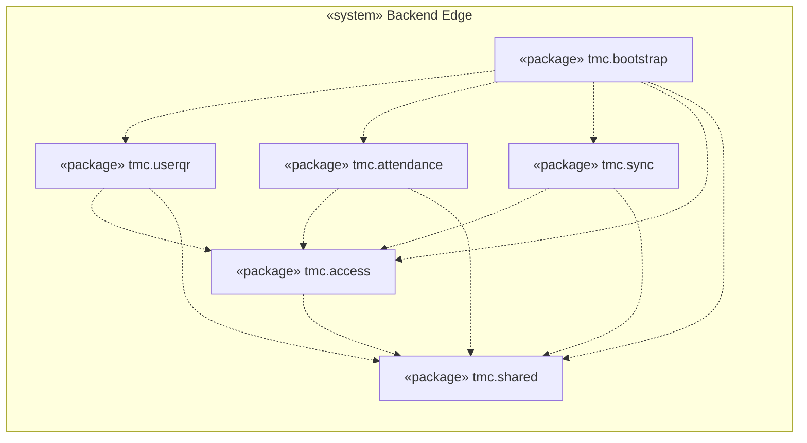
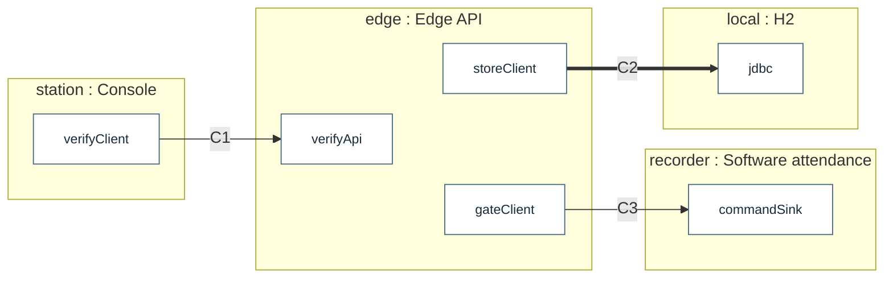
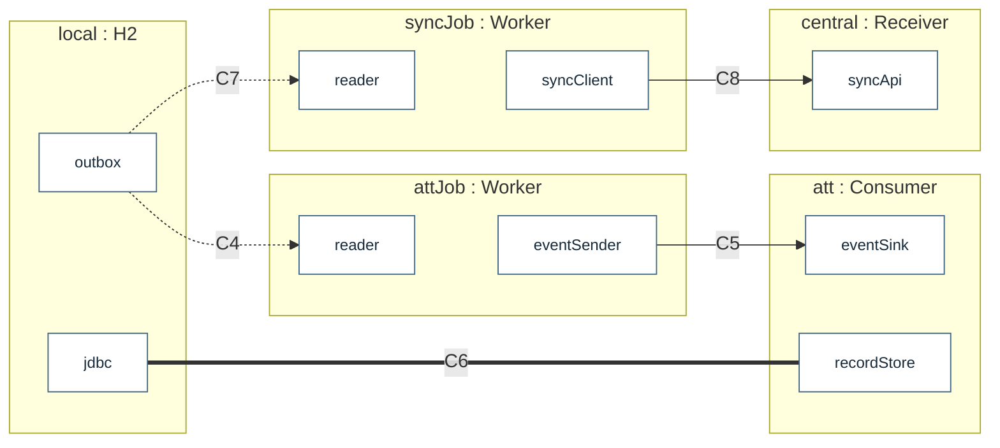
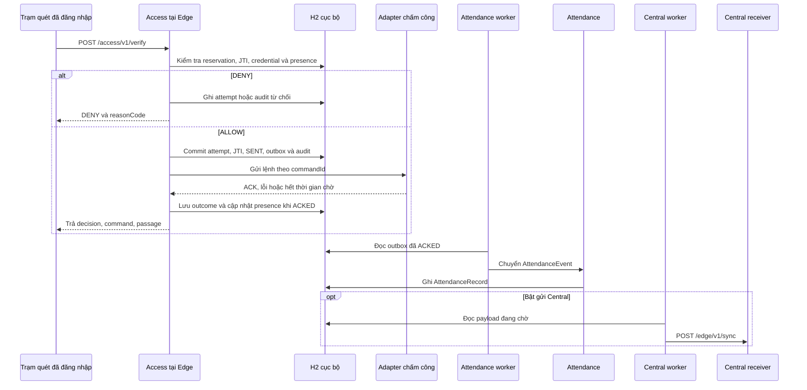
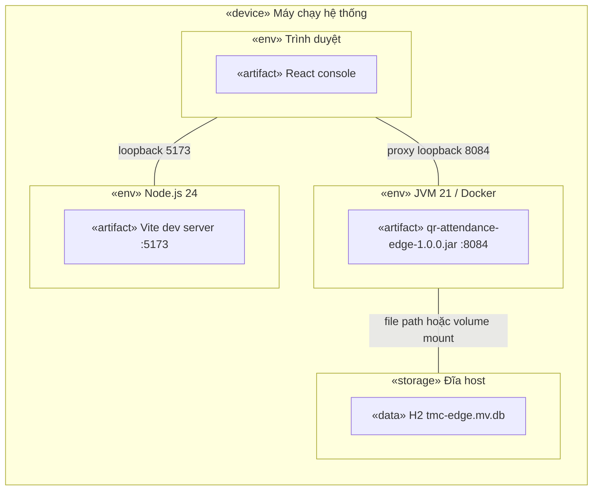

# TMC QR Attendance & Access Control

[](https://github.com/lazy128/tmc-qr-attendance/actions/workflows/ci.yml)

Hệ thống chấm công bằng QR dành cho Assignment M2. Edge xác minh lượt quét, ghi giờ vào và ra, áp dụng quyền xem bảng công và xuất dữ liệu cho Nhân sự.

[Cách chạy](#chạy-bản-nộp) · [Kiểm thử](#kiểm-thử) · [Ba view kiến trúc](#architecture-views) · [SOLID](#solid) · [Đối chiếu M2](#m2-checklist)

## Chạy bản nộp

Cần **Java 21** và **Node.js 24**. Profile mặc định `workplace` tạo DB H2 tại `backend/data/tmc-workplace.mv.db` và hai trạm vào, ra ở Bình Dương. Quản trị viên tự khai báo tài khoản và nhân viên.

~~~powershell
# Terminal backend, chạy từ thư mục gốc
.\backend\scripts\start-workplace.ps1 -Initialize -AllowHttp
~~~

Nhập mật khẩu tạm ít nhất 12 ký tự khi khởi tạo. Tài khoản đầu tiên là `admin`, có thể cấu hình qua `TMC_ADMIN_USERNAME`. Các lần khởi động sau dùng cùng lệnh bỏ `-Initialize`. `-AllowHttp` dành cho máy cá nhân hoặc mạng thử nghiệm riêng.

~~~powershell
# Terminal frontend, chạy từ thư mục gốc
cd frontend
npm ci
$env:VITE_EDGE_API_URL = '/edge-api'
npm run dev -- --strictPort
~~~

Mở [TMC Chấm công](http://localhost:5173). Đăng nhập bằng tài khoản quản trị và đổi mật khẩu tạm. Trong **Quản trị**, tạo một nhân viên, một tài khoản Nhân sự và hai tài khoản bảo vệ. Gán bảo vệ cổng vào cho `BD-G01` và bảo vệ cổng ra cho `BD-G01-OUT`. Mỗi tài khoản đổi mật khẩu ở lần đầu đăng nhập.

| Vai trò | Màn hình và quyền |
| --- | --- |
| Nhân viên | Mở **Mã QR của tôi** và xem bảng công của mình. |
| Quản lý | Mở QR của mình và xem bảng công trong cùng bộ phận, nhà máy. |
| Bảo vệ | Quét QR tại đúng trạm được gán. Hướng vào hoặc ra lấy từ cấu hình trạm. |
| Nhân sự | Xem bảng công, bổ sung giờ ra kèm lý do và xuất CSV hoặc XLSX theo tháng. |
| Quản trị viên | Tạo, khóa, mở khóa và đặt lại mật khẩu tài khoản. Cấu hình trạm, hướng, nhóm và giờ hoạt động. |

### Quét bằng hai thiết bị

Đăng nhập Nhân viên trên thiết bị hiển thị mã và Bảo vệ trên thiết bị quét. Hai thiết bị cần truy cập cùng địa chỉ ứng dụng. Trạm hỗ trợ camera trực tiếp, ảnh QR và mở liên kết QR bằng Camera của điện thoại. Khi mở liên kết, bảo vệ xác nhận tại trạm đã gán. Trang nhân viên tự cập nhật sau khi Edge lưu lượt công.

- Với HTTPS, cấu hình chứng chỉ thông qua `TMC_DEV_HTTPS_CERT` và `TMC_DEV_HTTPS_KEY`, rồi để cookie ở chế độ bảo mật mặc định. Thiết bị quét phải tin cậy chứng chỉ. Dùng `npm run dev -- --host 0.0.0.0 --strictPort` để mở ứng dụng trong mạng nội bộ.
- Khi kiểm tra qua Wi‑Fi riêng với HTTP, đặt `-FrontendOrigin 'http://192.168.1.25:5173'` và `-AllowHttp` ở backend, dùng IP LAN thật. Trình duyệt trên điện thoại có thể **Chụp mã QR** hoặc mở liên kết đọc bởi Camera. `VITE_QR_SCAN_ORIGIN` đặt cùng địa chỉ nếu màn hình nhân viên được mở qua localhost.
- Khi triển khai, phục vụ ứng dụng và proxy `/edge-api` trên cùng origin HTTPS, giữ backend ở mạng riêng và khai báo origin đó trong `TMC_CORS_ORIGINS`.

### Xử lý sự cố và kiểm soát dữ liệu

- **Mất mạng.** Trạm hiển thị lượt chờ. Khi kết nối lại, Kiosk gửi đúng dữ liệu với cùng `eventId`, kể cả khi phản hồi đầu tiên bị mất. Nếu tải lại trang, chỉ mã lượt được giữ trong phiên tab để tra kết quả đã lưu. Trường hợp máy chủ chưa nhận mã trước khi hết hạn, bảo vệ quét mã mới. Giờ công dùng giờ Edge nhận lượt.
- **Quét đồng thời.** Các trạm gửi độc lập. DB giữ kết quả theo `eventId`, chặn dùng lại JWT theo `(site_id, jti)`, khóa theo thông tin xác thực khi ghi và kiểm tra lại trạng thái vào/ra trước khi chốt. Một lượt có thể được gửi lại nhiều lần nhưng chỉ được ghi một lần.
- **Đúng nhân viên.** API cấp QR lấy nhân viên từ phiên đăng nhập. API quét kiểm tra vai trò Bảo vệ và chính xác trạm được giao. Kiosk hiện tên nhân viên đã xác minh để đối chiếu tại cổng.
- **JWT.** Phiên đăng nhập dùng JWT HS256 trong cookie `HttpOnly`, `SameSite=Strict` và mặc định `Secure`. DB kiểm tra phiên còn hiệu lực. Đổi mật khẩu, đặt lại mật khẩu và khóa tài khoản thu hồi các phiên liên quan. Mật khẩu được lưu dưới dạng BCrypt. QR dùng JWT ES256 có thời hạn 30 giây và phiên bản thẻ.
- **DB.** Hồ sơ, tài khoản, phiên, trạm, lượt quét, chấm công và nhật ký được lưu trong H2 dạng tệp. Sao lưu tệp DB khi backend đã dừng. Script tạo khóa phiên ở `backend/data/workplace-session.key`. Giữ khóa và bản sao DB riêng tư. Bảng tính được tạo từ chấm công đã lưu và ghi ra `backend/exports/workplace`.
- **Phạm vi chạy.** Bản nộp ghi nhận chấm công trong phần mềm trên một Edge và một DB. Phần điều khiển turnstile vật lý và đồng bộ an toàn nhiều Edge cần tích hợp riêng. Các profile kiểm thử kiến trúc cũ dùng dữ liệu riêng và chỉ được chọn tường minh.

## Kiểm thử

| Phần | Lệnh |
| --- | --- |
| Backend | Trong `backend/`, chạy `.\mvnw.cmd verify`. `WorkplaceFlowTest` kiểm tra vai trò, JWT, quét đồng thời, truy vấn lại và dữ liệu còn sau khi đóng DB. |
| Frontend | Trong `frontend/`, chạy `npm ci`, `npm run typecheck`, `npm test` và `npm run build`. |
| Trình duyệt | Chạy profile `workplace` với DB kiểm thử riêng và cấu hình HTTP cục bộ. Đặt `E2E_ADMIN_PASSWORD` bằng mật khẩu tạm khi tạo DB kiểm thử, chạy `npx playwright install chromium` rồi `npm run test:e2e` trong `frontend/`. Bài kiểm thử tạo tài khoản riêng, làm mất phản hồi quét và kiểm tra báo cáo. |

[API và cấu hình backend](backend/README.md) · [Cấu trúc frontend](frontend/README.md)

## Cách tổ chức repo

```text
backend/                 Java, Spring Boot, H2 và test
frontend/                React, TanStack Start và test
Phase1_Architecture.md   Thiết kế tổng thể, ADR và truy vết Phase 0–1
.github/workflows/        CI backend và frontend
```

[Cấu hình, API, Docker và metrics backend](backend/README.md) · [Cấu trúc và cấu hình frontend](frontend/README.md)

## Architecture Views

Ba hình dưới đây mô tả **bản Phase 2**, theo Chương 6 của bài giảng. Luồng mặc định là chấm công trên một Edge. Thiết kế Phase 0–1 trình bày phương án cho hai nhà máy. [Thiết kế Phase 0–1](Phase1_Architecture.md)

| View | Thành phần trên hình | Quan hệ được biểu diễn |
| --- | --- | --- |
| Module, slide 15–17 và 27–30 | Package hoặc đơn vị triển khai mã nguồn | Bao chứa `is-part-of` và phụ thuộc tĩnh `depends-on` |
| Component-and-Connector, slide 36–43 và 45–51 | Instance lúc chạy, port và connector | Port của component gắn vào một vai trò của connector |
| Allocation, deployment style, slide 52–56 và 62–64 | Máy, môi trường thực thi và artifact | Artifact đặt trên node, communication association nối các node |

### Module View

**Hình MV-1 · Decomposition and uses.** Hình chỉ xét các package Java của backend. Khung lồng nhau là `is-part-of`. Mũi tên đứt đi từ package **dùng** sang package **được dùng** trong mã nguồn.



| Module | Trách nhiệm và interface |
| --- | --- |
| [`tmc.access`](backend/src/main/java/tmc/access/) | Sở hữu `AccessAttempt`, used JTI, idempotency, presence và Edge outbox. Application dùng các port như `TokenValidator`, `AttemptStore` và `GateCommandSender`. |
| [`tmc.userqr`](backend/src/main/java/tmc/userqr/) | Cấp QR ES256 và thu hồi credential qua các port credential/token của Access. |
| [`tmc.attendance`](backend/src/main/java/tmc/attendance/) | Nhận `AttendanceEvent` bằng `AttendanceRecorder`. Quản lý bảng `attendance_record`, eligibility, tra cứu và CSV. API dùng permission/scope ports từ Access. |
| [`tmc.sync`](backend/src/main/java/tmc/sync/) | Nhận `EdgeSyncEvent` từ `shared`, chuyển sang kiểu domain Access để chống trùng và phát hiện cùng JTI ở nhiều site. |
| [`tmc.shared`](backend/src/main/java/tmc/shared/) | Tài khoản, phiên JWT và hồ sơ nhân viên. Chứa clock, ID, audit, correlation ID, DTO `EdgeSyncEvent` và port `CentralOutbox`. |
| [`tmc.bootstrap`](backend/src/main/java/tmc/bootstrap/) | Ghép Spring beans, worker và mapping từ `AccessAttempt` sang `AttendanceEvent`. |

<details>
<summary>Cây package và vị trí tìm code</summary>

```text
backend/src/main/java/tmc/
├── access/
│   ├── api/                  REST verify, passage và correction
│   ├── application/          Use case, pipeline, step và policy/scope ports
│   ├── domain/               Aggregate, trạng thái, value object và ports
│   └── infrastructure/
│       ├── persistence/      JDBC, in-memory stores và codec outbox
│       ├── security/         ES256 và quyền theo tài khoản
│       ├── snapshot/         Snapshot dạng file và in-memory
│       └── turnstile/        Xác nhận phần mềm, adapter kiểm thử, timeout và metrics
├── userqr/                   API và use case cấp/thu hồi QR
├── attendance/               API, application, domain, contract và stores
├── sync/                     Central API và bộ nhận demo
├── shared/                   Tài khoản, JWT phiên, audit, clock và outbox contract
└── bootstrap/
    ├── mapping/              Chuyển AccessAttempt thành AttendanceEvent
    └── worker/               Attendance, Central sync, đối soát, snapshot và HR
```

Frontend chia theo `access`, `userqr`, `attendance` và `shared`. [Cây frontend chi tiết](frontend/README.md)

</details>

**Biến thể và lý do.** Module phân lớp với port và adapter để đổi Turnstile hoặc strategy chấm công ở bootstrap. Attendance ghi bảng riêng qua event contract. [ArchUnit](backend/src/test/java/tmc/architecture/ArchitectureRulesTest.java) kiểm tra vòng phụ thuộc và ngăn domain/application import framework hoặc infrastructure. Các phụ thuộc sang Access ở trên phản ánh code hiện tại, gồm những chỗ chưa tách hoàn toàn qua package `contract`.

### Component-and-Connector View

**Hình CC-1 · Các instance trên đường quét và đồng bộ.** Hai phần dùng cùng instance `local`. Khung ghi `instance : type`. Ô nhỏ là **port**. Mỗi connector nối hai port và có mã để tra hợp đồng trong bảng. Ký hiệu box-and-line theo slide 43.

**CC-1a · Đường quét**



**CC-1b · Xử lý sau lượt quét**



| Instance | Vai trò lúc chạy |
| --- | --- |
| `station`, `edge` | Trạm gửi JWT phiên cùng QR. Edge đối chiếu quyền của bảo vệ với trạm và lưu quyết định. |
| `recorder`, `local` | Adapter xác nhận ghi nhận phần mềm. H2 lưu tài khoản, phiên, hồ sơ, trạng thái Access, outbox và attendance. |
| `attJob`, `att` | Worker poll kết quả ACKED. Consumer áp dụng eligibility và ghi bản ghi. |
| `syncJob`, `central` | Worker tùy chọn gửi batch. Receiver demo xử lý và chống trùng trong bộ nhớ. |

| Connector | Kiểu và chiều | Vai trò, hợp đồng và hành vi |
| --- | --- | --- |
| C1 | Liền · HTTP request/response | Trạm gọi `POST /access/v1/verify`. Edge trả kết quả và mã lượt. Khi mất phản hồi, trạm gửi lại cùng `eventId` hoặc tra kết quả đã lưu. |
| C2 | Đậm · JDBC transaction | Edge ghi attempt, JTI, SENT, outbox và audit trước lệnh cổng. Giao dịch sau lưu outcome. |
| C3 | Liền · Gọi Java trong process | `GateCommandSender` dùng adapter xác nhận phần mềm trong profile `workplace`. |
| C4 / C7 | Đứt · Outbox, chiều **dữ liệu đi** | Worker chủ động poll H2. C4 nhận kết quả ACKED. C7 chạy khi bật gửi Central và có thể gửi lại. |
| C5 | Liền · Gọi Java trong process | Attendance worker chuyển `AttendanceEvent` cho consumer. |
| C6 | Đậm, không mũi tên · JDBC | Attendance là caller. Consumer áp dụng eligibility rồi ghi bảng riêng trong H2. |
| C8 | Liền · HTTP request/response trong worker | Worker POST batch tới `/edge/v1/sync`. Receiver chống trùng theo `eventId`. Việc gửi diễn ra ngoài request C1. |

Ở đường liền hoặc đậm có mũi tên, chiều đi từ bên **khởi tạo request/gọi hàm** sang bên đáp ứng. C&C ghi topology và các connector. Sequence bên dưới mô tả thứ tự của một lần quét.

<details>
<summary>Sequence minh họa một lần quét</summary>



</details>

**Biến thể và lý do.** H2 và adapter chấm công chạy trên Edge. Outbox ghi chấm công ngoài đường quét. Trong cấu hình kiến trúc nhiều Edge, worker gửi Central có thể được bật riêng. API, health và luồng tích hợp được mô tả trong runbook. [Runbook backend](backend/README.md)

- **Scan và retry.** Edge xác thực trạm, kiểm tra scope rồi tra idempotency. Retry cùng `eventId` và cùng fingerprint có thể nhận `409 REQUEST_IN_PROGRESS` hoặc kết quả đã lưu. Một JTI được dùng một lần trong mỗi site. Central phát hiện dùng lại giữa site sau khi đồng bộ.
- **Giao dịch trước lệnh cổng.** Nếu transaction ghi `SENT` lỗi, Edge từ chối, JTI được rollback và lệnh chưa được gửi. Sau khi gửi, timeout tạo `UNKNOWN`. Worker truy vấn trạng thái theo ID thay cho việc gửi lại lệnh.
- **Ba trạng thái độc lập.** `decision` là kết quả kiểm tra quyền. `command` là trạng thái lệnh điều khiển. `passage` là trạng thái chứng cứ qua cổng. ACK tạo `ACK_ONLY` và cập nhật presence. Chứng cứ riêng mới tạo `CONFIRMED`. `NOT_AVAILABLE` nghĩa là chưa cấu hình nguồn cảm biến, còn `UNCONFIRMED` nghĩa là đang chờ chứng cứ.
- **Chấm công.** Worker chỉ đưa ACKED vào attendance. `ACK_ONLY` bật cờ rà soát HR. UNKNOWN ở luồng đối soát; FAILED bị loại khỏi xuất công. Guard demo có thể sửa quên quét ra với audit mà không sinh scan chấm công mới.
- **Mất WAN.** Đường verify dùng dữ liệu cục bộ. Khi chạy với snapshot, Edge fail-closed nếu snapshot stale. Thu hồi trong cửa sổ staleness vẫn có thể chưa được Edge biết. Báo động JTI khác site chỉ xuất hiện sau sync.

### Allocation View

**Hình AL-1 · Cách triển khai bản nộp.** Khung ngoài là thiết bị. `«env»` là môi trường thực thi. Artifact đặt trong khung nơi chạy hoặc lưu. Mạng loopback kết nối frontend với Edge.



| Phần tử môi trường | Phần mềm được đặt ở đó | Biến thể và ràng buộc |
| --- | --- | --- |
| Máy chạy hệ thống và trình duyệt | React và Node.js phục vụ Vite | Frontend nghe cổng 5173, gọi Edge qua proxy cùng origin. |
| JVM hoặc container | Edge API, adapter chấm công, Attendance và các worker. | Chạy Maven Wrapper, JAR hoặc Docker Compose. Compose publish cổng 8084 trên loopback. |
| Đĩa host | File dữ liệu H2, outbox và attendance | Maven dùng `backend/data/`. Docker lưu vào named volume `edge-data`. |

**Liên hệ giữa ba view.** `tmc.access` tạo instance `edge` và adapter ghi công. Các instance chạy từ JAR trong JVM hoặc container. Bản nộp dùng tài khoản và H2 trên một Edge. Phân bố vật lý hai nhà máy thuộc thiết kế Phase 1. [Bình Dương, Long An và Central](Phase1_Architecture.md#6-allocation-view)

## SOLID

**Phạm vi nộp Task 2 là Access.** Đề M2 trang 3 yêu cầu hiện thực ít nhất một module chính và áp dụng SOLID. Bản demo hiện thực luồng Access tại Edge, cùng UserQr, Attendance và Sync ở mức hỗ trợ luồng chính. Mức bao phủ **Task 2** và mức nghiệm thu **toàn hệ thống** được đánh giá riêng theo Phần I.

### Bằng chứng trong code

| Nguyên lý | Áp dụng ở đâu | Bằng chứng trong code và test |
| --- | --- | --- |
| **S · Single Responsibility** | Access chia logic xác minh theo từng bước. Attendance tách áp dụng policy khỏi định dạng CSV. | Có test riêng cho từng bước xác minh. [Các VerificationStep](backend/src/main/java/tmc/access/application/step/) · [Test từng bước](backend/src/test/java/tmc/access/application/step/) · [RecordAttendance](backend/src/main/java/tmc/attendance/application/RecordAttendance.java) · [AttendanceCsv](backend/src/main/java/tmc/attendance/application/AttendanceCsv.java) |
| **O · Open/Closed** | Access nhận danh sách `VerificationStep` có thứ tự. Cổng và chính sách eligibility được thay qua interface. | [VerifyAccessUseCase](backend/src/main/java/tmc/access/application/VerifyAccessUseCase.java), [EligibilityPolicy](backend/src/main/java/tmc/attendance/domain/EligibilityPolicy.java). Test `acceptsAnExtraStepAndReturnsInProgressWhileCommandIsPending` đăng ký bước mới qua constructor. |
| **L · Liskov Substitution** | Access dùng fake, simulator và HTTP skeleton qua cùng `GateCommandSender`. Outcome được biểu diễn bằng `GateResult` cho mọi adapter. | [GateCommandSenderContractTest](backend/src/test/java/tmc/access/infrastructure/turnstile/GateCommandSenderContractTest.java) chạy với ba adapter. Test áp dụng outcome lên `AccessAttempt.withCommand` và xác nhận ACK chỉ tạo `ACK_ONLY`. HTTP skeleton trả FAILED cho đến khi có vendor contract. |
| **I · Interface Segregation** | Access tách gửi lệnh, đọc trạng thái và nhận chứng cứ. UserQr dùng reader, writer, signer theo tác vụ. Worker sync chỉ cần lấy và đánh dấu payload. | [Access ports](backend/src/main/java/tmc/access/domain/port/), [CentralOutbox](backend/src/main/java/tmc/shared/outbox/CentralOutbox.java), [CentralOutboxWorker](backend/src/main/java/tmc/bootstrap/worker/CentralOutboxWorker.java). Contract test gửi lệnh chỉ cần `GateCommandSender`. |
| **D · Dependency Inversion** | Các use case Access, UserQr và Attendance nhận port qua constructor, gồm `ClockProvider` và `IdGenerator` ở những chỗ cần thời gian hoặc ID. Bootstrap ghép các implementation. | [AccessConfiguration](backend/src/main/java/tmc/bootstrap/AccessConfiguration.java), [UserQrConfiguration](backend/src/main/java/tmc/bootstrap/UserQrConfiguration.java), [AttendanceConfiguration](backend/src/main/java/tmc/bootstrap/AttendanceConfiguration.java). [ArchitectureRulesTest](backend/src/test/java/tmc/architecture/ArchitectureRulesTest.java) kiểm tra hướng phụ thuộc, vòng giữa các package cấp module, và ngăn Access, UserQr, Attendance import infrastructure của nhau. |

### Thay đổi trước và sau có trong repo

Các ví dụ dưới đây dựa trên source đã lưu trong Git. Chúng có thể dùng để mở code tương ứng khi bảo vệ.

| Nguyên lý | Trước | Sau |
| --- | --- | --- |
| S | [`JdbcAttemptStore` cũ][old-store] vừa điều khiển transaction vừa dựng tay từng key JSON của outbox trong `payload()`. | [`EdgeOutboxCodec`](backend/src/main/java/tmc/access/infrastructure/persistence/EdgeOutboxCodec.java) đảm nhiệm format. Store gọi `outboxCodec.encode(attempt)` bên trong transaction. [Test tương thích payload cũ](backend/src/test/java/tmc/access/infrastructure/persistence/EdgeOutboxCodecTest.java) so sánh cả chuỗi vì outbox dùng nội dung payload để xác nhận phiên bản. |
| O | [`AccessConfiguration` trước observability][old-wiring] truyền `gate` vào pipeline. | Bootstrap truyền `new MeteredGateCommandSender(gate, metrics)`. Bộ đếm được thêm qua decorator, `GateCommandStep` vẫn nhận cùng port. Đây là một lần mở rộng thực tế của thiết kế. |
| L | [Store JDBC trước refactor][old-store] khai báo `implements OutboxPublisher` nhưng `publish(…)` ném `UnsupportedOperationException`. | JDBC bỏ khai báo port không thực hiện được. Việc ghi outbox là phần của hợp đồng `AttemptStore.persistPrepared`, cùng transaction với attempt và JTI. Contract Turnstile kiểm tra quy tắc thay thế ở đường điều khiển cổng. |
| I | [Worker Central cũ][old-worker] nhận toàn bộ `JdbcAttemptStore` để gọi đúng hai phương thức. | Worker nhận `CentralOutbox` với `pendingCentral(limit)` và `centralDone(payload)`. Port phản ánh đúng nhu cầu của phía gửi. |
| D | [Receiver cũ][old-sync] nằm trong `tmc.shared.outbox` và import `AccessAttempt`. Access cũng import clock và audit từ `shared`, sinh phụ thuộc hai chiều. | Receiver nằm trong `tmc.sync`. `tmc.shared.outbox` giữ DTO `EdgeSyncEvent` và port thuần Java. Test ArchUnit kiểm tra vòng trực tiếp trên các package hiện có. |

Những ranh giới này cho phép test Access với fake Turnstile và thay rule eligibility mà không cần thay API. Một trade-off là store JDBC vẫn giữ nhiều thao tác cùng nhau để bảo đảm transaction nguyên tử. Việc tách phần codec và port đọc outbox giảm trách nhiệm của store mà vẫn giữ ranh giới commit rõ ràng.

## Reflection

1. **OCP và thứ tự xác minh.** Có thể đăng ký thêm `VerificationStep` qua constructor, nhưng mốc `step.order() >= 30` ngầm quyết định bước chạy trước hay sau idempotency. Nhóm bước trước mốc bảo đảm trạm được xác thực và đúng site trước khi Edge trả kết quả đã lưu. Một phase được khai báo rõ khi đăng ký step sẽ giúp kiểm tra ràng buộc này khi thêm bước. [VerifyAccessUseCase](backend/src/main/java/tmc/access/application/VerifyAccessUseCase.java) · [VerificationPipelineTest](backend/src/test/java/tmc/access/application/VerificationPipelineTest.java)
2. **SRP và trạng thái dùng chung.** `VerifyAccessUseCase` vừa điều phối pipeline, vừa giữ chỗ idempotency, tạo và lưu bản ghi từ chối, rồi xử lý trường hợp lỗi sau khi đã gửi lệnh. Các field public trong `AccessContext` khiến quan hệ giữa những bước này chỉ thể hiện qua thứ tự thực thi. Ví dụ, `GateCommandStep` dựa vào `persisted` và `attempt` do bước lưu thiết lập. Một phương thức ghi nhận attempt đã lưu có thể cập nhật cả hai cùng lúc và giữ điều kiện đó ngay trong context. [AccessContext](backend/src/main/java/tmc/access/application/AccessContext.java) · [GateCommandStepTest](backend/src/test/java/tmc/access/application/step/GateCommandStepTest.java)
3. **Bằng chứng ở cấp step.** Test token trước đây dùng claim giả lập. Test riêng hiện ký và xác minh ES256 bằng khóa test, kiểm tra riêng sai `kid`, sai chữ ký và các biên skew. Ma trận credential, scope và anti-passback xác nhận mã từ chối của từng bước. Test HTTP/H2 kiểm tra hai hành vi phụ thuộc vào tích hợp là rollback JTI khi outbox lỗi và HTTP 409 khi request còn xử lý. [Test từng bước](backend/src/test/java/tmc/access/application/step/) · [EdgeFlowTest](backend/src/test/java/tmc/bootstrap/EdgeFlowTest.java)

## Sai lệch so với thiết kế

Phase 0–1 dùng `EDGE_VERIFY` và `STRICT` để mô tả cách vận hành khi mất WAN. Demo dùng trạng thái snapshot `FRESH` và `STALE` khi chạy ở cấu hình snapshot. `FRESH` cho phép tiếp tục kiểm tra cục bộ. Tại bước policy, `STALE` dẫn đến `SNAPSHOT_STALE` và bỏ qua bước gửi lệnh cổng. [ADR-05](Phase1_Architecture.md#3-architecture-decisions-adr-index)

## M2 Checklist

### So với yêu cầu triển khai Phase 2

| Hạng mục | Đã có trong repo | Giới hạn hoặc sai lệch |
| --- | --- | --- |
| Task 2 · nghiệp vụ chính | Access xác minh tại Edge, cấp QR theo phiên, quản trị tài khoản và trạm, ghi công và xuất báo cáo. | Tích hợp cổng vật lý, đồng bộ nhiều Edge có xác thực và override offline hai người thuộc phạm vi thiết kế. |
| Pipeline và trạng thái | Các bước xác thực, chữ ký/thời gian, credential, policy, replay, anti-passback, transaction, lệnh và outcome. Ba trạng thái được giữ riêng. | Scope của trạm được kiểm tra trước khi trả một kết quả idempotent. Idempotency nằm trong use case. Passage là endpoint riêng và không nằm trên đường gửi lệnh. |
| Port và contract | Wiring ở bootstrap. Attendance nhận `AttendanceEvent` và ghi bảng riêng. Edge và Central dùng `EdgeSyncEvent`. | UserQr dùng các port credential/token của Access và Attendance dùng policy/scope ports của Access. Sync ánh xạ DTO sang `AccessAttempt` ở bộ nhận. Ranh giới giữa các module chưa đạt quy tắc tuyệt đối chỉ import từ package `contract`. |
| Runtime và tích hợp | Java 21, giao dịch H2, outbox, QR ES256, JWT phiên, quyền từ DB và cấu hình snapshot. | Bản nộp chạy một Edge với adapter chấm công phần mềm. Đồng bộ nhiều Edge, cổng vật lý và QR ký bằng khóa trên thiết bị thuộc phạm vi tích hợp. |
| Mức bao phủ test | Test riêng cho cả 10 step, contract, HTTP với H2, fault injection cho outbox và ArchUnit. | Load harness dùng Node.js. Bộ test dùng dữ liệu và cấu hình demo. |

### Đối chiếu AC trong Phần I

| AC | Bằng chứng đang có | Việc còn thiếu để nghiệm thu |
| --- | --- | --- |
| AC-01 · QR và từ chối | Test riêng kiểm tra chữ ký ES256, `kid`, issuer/audience, biên thời gian, credential và thiết bị, station scope, snapshot, replay, anti-passback và lỗi lưu. `EdgeFlowTest` xác nhận không phát lệnh khi lưu thất bại. | Chạy ma trận QR/credential với dữ liệu và policy TMC duyệt. |
| AC-02 · lệnh cổng và passage | `GateCommandSenderContractTest`, `AccessAttemptTest` và `EdgeFlowTest` kiểm tra outcome riêng với passage. | Kiểm thử theo API và nguồn cảm biến thực. |
| AC-03 · Attendance Transaction | `EdgeFlowTest` kiểm tra ghi bản ghi và cờ HR review. `AttendanceEligibilityTest` kiểm tra ACKED-only. | Test từng trường employee, site, time, direction và evidence theo schema được duyệt. |
| AC-04 · độ bền dữ liệu | `EdgeFlowTest` ép lỗi insert outbox, kiểm tra JTI rollback và không phát lệnh. | Khởi động lại Edge/Central và đối soát số liệu theo định nghĩa normal operation. |
| AC-05 · idempotency | `EdgeFlowTest` kiểm tra replay kết quả cũ, hai request đồng thời dùng một JTI và HTTP 409 `REQUEST_IN_PROGRESS` có thể thử lại. `VerificationPipelineTest` kiểm tra trạng thái in-progress trong lúc gửi lệnh và việc gửi lệnh một lần khi retry sau timeout. | Kiểm thử quy tắc retry trên thiết bị thật. |
| AC-06 · thời gian kiosk | [Đo tải local](backend/README.md) thực hiện 800 scan/site với hai site đồng thời trong 30 giây, chậm nhất 74,55 ms ở ranh giới HTTP Edge. | Chạy kịch bản chính thức 30 phút tại từng site và đo tới kiosk với LAN/Turnstile thật. |
| AC-07 · gửi HR trước 12:00 ngày 1 | `EdgeFlowTest` dùng clock cố định, xác nhận batch tháng chỉ tạo một lần và lưu ACK mô phỏng trước trưa. | Schema, calendar, delivery ACK và đối soát với HR/Payroll thật. |
| AC-08 · RBAC | `EdgeFlowTest` kiểm tra yêu cầu token, Admin bị từ chối đọc attendance, scope Employee và quyền export của HR. | Ma trận role/scope TMC phê duyệt và test quản trị role/config. |
| AC-09 · audit | `EdgeFlowTest` đọc và tính lại hash audit, phát hiện khi đổi một trường. Có audit cho allow/deny, QR, correction và các thao tác attendance đã tích hợp. | Event catalog, quyền tra cứu, chống xóa và chính sách retention đầy đủ. |
| AC-10 · dữ liệu cá nhân | Test HTTP kiểm tra CSV không chứa QR gốc và log verify không chứa QR/token/dữ liệu nhân viên đưa vào test. | Rà dữ liệu QR/report/export và retention theo policy TMC/pháp lý. |

### Tài liệu đối chiếu

- Đề `SA_CC_hk261_Assignment_M2.pdf`, trang 2–3, phần scope, Task 1 và Task 2.
- `Phần I (fixed).docx`, mục 1.5.6, bảng Acceptance Criteria và Requirements Traceability Matrix.
- Yêu cầu Phase 2 đã thống nhất, mục 1–6 và 8, cùng slide `Chapter2.2_SA_CC.pdf` về LSP, ISP và DIP.
- `Chapter6_SA_CC.pdf`, slide 12–17, 27–30, 36–51 và 52–64, cho cách trình bày, ký hiệu và ranh giới giữa ba view.
- [Kiến trúc và ADR Phase 0–1](Phase1_Architecture.md) · [Kiến trúc của code đang chạy](#architecture-views)

[old-store]: https://github.com/lazy128/tmc-qr-attendance/blob/9563ddf618ccb3f30733189c6abf701d17a14058/backend/src/main/java/tmc/access/infrastructure/JdbcAttemptStore.java
[old-wiring]: https://github.com/lazy128/tmc-qr-attendance/blob/f49977eea377ec33298eb687ca38aa3a0dae8fe1/backend/src/main/java/tmc/bootstrap/AccessConfiguration.java
[old-worker]: https://github.com/lazy128/tmc-qr-attendance/blob/9563ddf618ccb3f30733189c6abf701d17a14058/backend/src/main/java/tmc/bootstrap/CentralOutboxWorker.java
[old-sync]: https://github.com/lazy128/tmc-qr-attendance/blob/9563ddf618ccb3f30733189c6abf701d17a14058/backend/src/main/java/tmc/shared/outbox/CentralSyncReceiver.java
