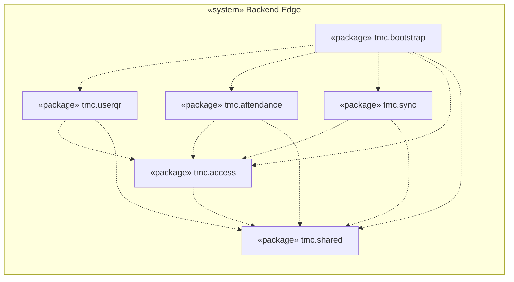
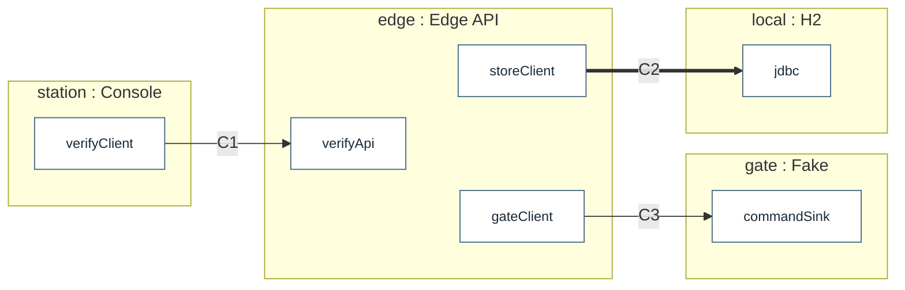
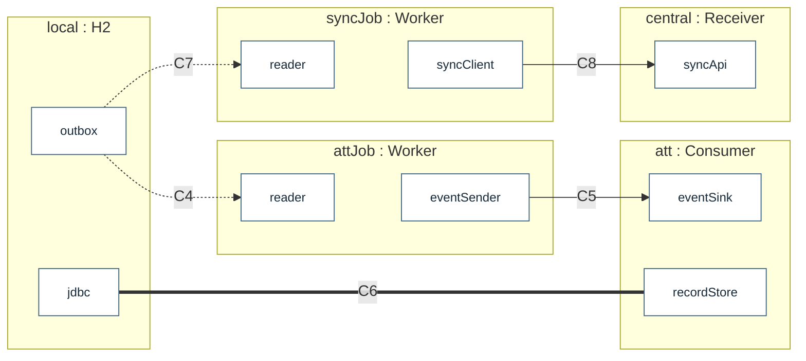
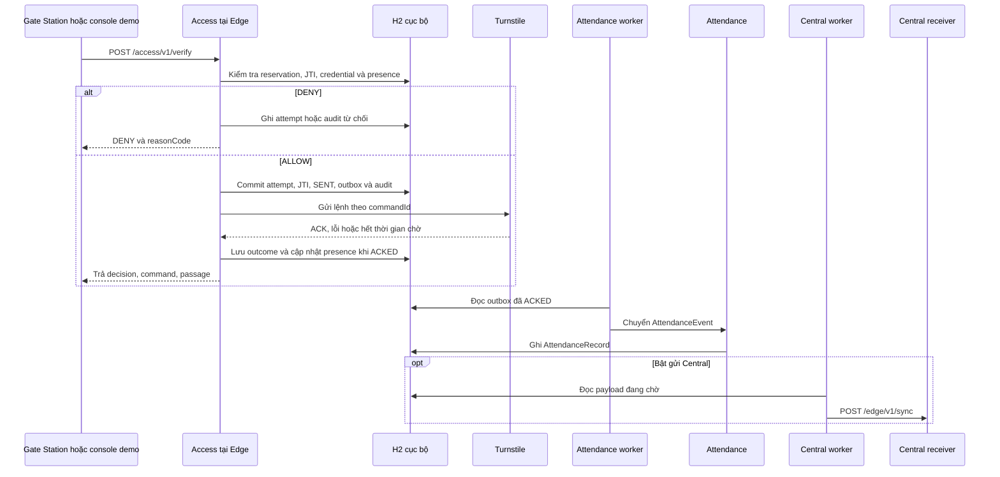
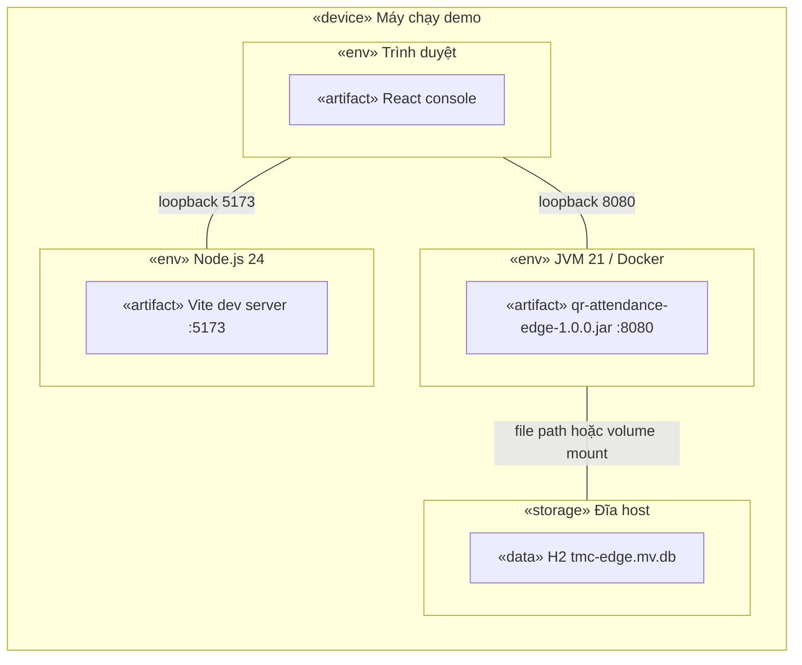

# TMC QR Attendance & Access Control

[](https://github.com/lazy128/tmc-qr-attendance/actions/workflows/ci.yml)

Ứng dụng mẫu cho Assignment M2. **Access** là module chính của Task 2. Demo cho phép cấp QR ngắn hạn, kiểm tra truy cập tại Edge, điều khiển cổng mô phỏng, ghi nhận công và tải CSV theo tháng.

[Cách chạy](#chạy-demo) · [Ba view kiến trúc](#architecture-views) · [SOLID](#solid) · [Đối chiếu M2](#m2-checklist)

## Chạy demo

Cần **Java 21** và **Node.js 24**. Maven Wrapper tự tải Maven trong lần chạy đầu. Mở hai terminal từ thư mục gốc.

**Terminal 1 · Backend**

```powershell
cd backend
$env:TMC_HR_DEMO_TOKEN = 'tmc-local-hr'
.\mvnw.cmd spring-boot:run
```

Trên macOS/Linux, đặt token bằng `export TMC_HR_DEMO_TOKEN=tmc-local-hr` và chạy `./mvnw spring-boot:run`. Docker Compose cũng có sẵn. [Cấu hình backend và Docker](backend/README.md)

**Terminal 2 · Frontend**

```powershell
cd frontend
Copy-Item .env.example .env
npm ci
npm run dev
```

Mở [console](http://localhost:5173). Ở **Access check**, giữ `SITE-1` / `GATE-1` và `demo-credential` / `demo-device`. Bấm **Issue QR token**, rồi **Verify at gate** trong 30 giây. Ở **Attendance records**, nhập `tmc-local-hr`, bấm **Load records** và chọn tháng cần tải CSV. Bản ghi xuất hiện sau khi worker xử lý outbox.

## Chạy kiểm thử

| Phần | Thư mục | Lệnh |
| --- | --- | --- |
| Backend | `backend/` | `.\mvnw.cmd test` trên Windows hoặc `./mvnw test` trên macOS/Linux. Dùng `verify` để chạy thêm bước đóng gói JAR. |
| Frontend | `frontend/` | `npm test`, `npm run typecheck`, `npm run build`. |
| GitHub Actions | `.github/workflows/ci.yml` | Chạy `mvn -B test` cho backend trên Ubuntu với Java 21. |

## Cách tổ chức repo

```text
backend/                 Java, Spring Boot, H2 và test
frontend/                React, TanStack Start và test
Phase1_Architecture.md   Thiết kế tổng thể, ADR và truy vết Phase 0–1
.github/workflows/        CI backend trên Java 21
```

[Cấu hình, API, Docker và metrics backend](backend/README.md) · [Cấu trúc và cấu hình frontend](frontend/README.md)

## Architecture Views

Ba hình dưới đây mô tả **bản demo Phase 2 đang chạy**, theo Chương 6 của bài giảng. [Thiết kế Phase 0–1](Phase1_Architecture.md) dùng cùng ba loại view để trình bày phương án cho hai nhà máy. Mỗi view có hình chính, chú giải, catalog và thông tin về các biến thể.

| View | Thành phần trên hình | Quan hệ được biểu diễn |
| --- | --- | --- |
| Module, slide 15–17 và 27–30 | Package hoặc đơn vị triển khai mã nguồn | Bao chứa `is-part-of` và phụ thuộc tĩnh `depends-on` |
| Component-and-Connector, slide 36–43 và 45–51 | Instance lúc chạy, port và connector | Port của component gắn vào một vai trò của connector |
| Allocation, deployment style, slide 52–56 và 62–64 | Máy, môi trường thực thi và artifact | Artifact đặt trên node, communication association nối các node |

### Module View

**Hình MV-1 · Decomposition and uses.** Hình chỉ xét các package Java của backend. Khung lồng nhau là `is-part-of`. Mũi tên đứt đi từ package **dùng** sang package **được dùng** trong mã nguồn.



| Module | Trách nhiệm và interface |
| --- | --- |
| [`tmc.access`](backend/src/main/java/tmc/access/) | Sở hữu `AccessAttempt`, used JTI, idempotency, presence và Edge outbox. Application dùng các port như `TokenValidator`, `AttemptStore` và `GateCommandSender`. |
| [`tmc.userqr`](backend/src/main/java/tmc/userqr/) | Cấp QR ES256 và thu hồi credential qua các port credential/token của Access. |
| [`tmc.attendance`](backend/src/main/java/tmc/attendance/) | Nhận `AttendanceEvent` bằng `AttendanceRecorder`. Quản lý bảng `attendance_record`, eligibility, tra cứu và CSV. API dùng permission/scope ports từ Access. |
| [`tmc.sync`](backend/src/main/java/tmc/sync/) | Nhận `EdgeSyncEvent` từ `shared`, chuyển sang kiểu domain Access để chống trùng và phát hiện cùng JTI ở nhiều site. |
| [`tmc.shared`](backend/src/main/java/tmc/shared/) | Clock, ID, audit, correlation ID, DTO `EdgeSyncEvent` và port `CentralOutbox`. |
| [`tmc.bootstrap`](backend/src/main/java/tmc/bootstrap/) | Ghép Spring beans, worker và mapping từ `AccessAttempt` sang `AttendanceEvent`. |

<details>
<summary>Cây package và vị trí tìm code</summary>

```text
backend/src/main/java/tmc/
├── access/
│   ├── api/                  REST verify, passage và correction
│   ├── application/          Use case, pipeline, step và policy/scope ports
│   ├── domain/               Aggregate, trạng thái, value object và ports
│   └── infrastructure/
│       ├── persistence/      JDBC, in-memory stores và codec outbox
│       ├── security/         ES256, xác thực trạm và quyền demo
│       ├── snapshot/         Snapshot dạng file và in-memory
│       └── turnstile/        Fake, simulator, HTTP skeleton, timeout và metrics
├── userqr/                   API và use case cấp/thu hồi QR
├── attendance/               API, application, domain, contract và stores
├── sync/                     Central API và bộ nhận demo
├── shared/                   Audit, clock, ID, outbox contract và filter HTTP
└── bootstrap/
    ├── mapping/              Chuyển AccessAttempt thành AttendanceEvent
    └── worker/               Attendance, Central sync, đối soát, snapshot và HR
```

Frontend chia theo `access`, `userqr`, `attendance`, `console` và `shared`. [Cây frontend chi tiết](frontend/README.md)

</details>

**Biến thể và lý do.** Module phân lớp với port và adapter để đổi Turnstile hoặc strategy chấm công ở bootstrap. Attendance ghi bảng riêng qua event contract. [ArchUnit](backend/src/test/java/tmc/architecture/ArchitectureRulesTest.java) kiểm tra vòng phụ thuộc và ngăn domain/application import framework hoặc infrastructure. Các phụ thuộc sang Access ở trên phản ánh code hiện tại, gồm những chỗ chưa tách hoàn toàn qua package `contract`.

### Component-and-Connector View

**Hình CC-1 · Các instance trên đường quét và đồng bộ.** Hai phần dùng cùng instance `local`. Khung ghi `instance : type`. Ô nhỏ là **port**. Mỗi connector nối hai port và có mã để tra hợp đồng trong bảng. Ký hiệu box-and-line theo slide 43.

**CC-1a · Đường quét**



**CC-1b · Xử lý sau lượt quét**



| Instance | Vai trò lúc chạy |
| --- | --- |
| `station`, `edge` | Console gửi scan. Edge xác minh, lưu quyết định và điều khiển cổng. |
| `gate`, `local` | Fake Turnstile trả outcome. H2 lưu trạng thái Access, outbox và attendance. |
| `attJob`, `att` | Worker poll kết quả ACKED. Consumer áp dụng eligibility và ghi bản ghi. |
| `syncJob`, `central` | Worker tùy chọn gửi batch. Receiver demo xử lý và chống trùng trong bộ nhớ. |

| Connector | Kiểu và chiều | Vai trò, hợp đồng và hành vi |
| --- | --- | --- |
| C1 | Liền · HTTP request/response | Console gọi `POST /access/v1/verify`. Edge trả decision, command, passage và correlation ID. |
| C2 | Đậm · JDBC transaction | Edge ghi attempt, JTI, SENT, outbox và audit trước lệnh cổng. Giao dịch sau lưu outcome. |
| C3 | Liền · Gọi Java trong process | Edge qua `GateCommandSender`, dùng fake adapter trong demo. ACK xác nhận lệnh. |
| C4 / C7 | Đứt · Outbox, chiều **dữ liệu đi** | Worker chủ động poll H2. C4 nhận kết quả ACKED. C7 chạy khi bật gửi Central và có thể gửi lại. |
| C5 | Liền · Gọi Java trong process | Attendance worker chuyển `AttendanceEvent` cho consumer. |
| C6 | Đậm, không mũi tên · JDBC | Attendance là caller. Consumer áp dụng eligibility rồi ghi bảng riêng trong H2. |
| C8 | Liền · HTTP request/response trong worker | Worker POST batch tới `/edge/v1/sync`. Receiver chống trùng theo `eventId`. Việc gửi diễn ra ngoài request C1. |

Ở đường liền hoặc đậm có mũi tên, chiều đi từ bên **khởi tạo request/gọi hàm** sang bên đáp ứng. C&C ghi topology và các connector. Sequence bên dưới mô tả thứ tự của một lần quét.

<details>
<summary>Sequence minh họa một lần quét</summary>



</details>

**Biến thể và lý do.** H2 và fake adapter chạy cục bộ cho demo. Central worker bật bằng cấu hình. Outbox giữ gửi Central và ghi chấm công ngoài đường quét. Khi có cảm biến, Edge nhận passage qua endpoint riêng. API, health, metrics và HR job nằm trong [runbook backend](backend/README.md).

- **Scan và retry.** Edge xác thực trạm, kiểm tra scope rồi tra idempotency. Retry cùng `eventId` và cùng fingerprint có thể nhận `409 REQUEST_IN_PROGRESS` hoặc kết quả đã lưu. Một JTI được dùng một lần trong mỗi site. Central phát hiện dùng lại giữa site sau khi đồng bộ.
- **Giao dịch trước lệnh cổng.** Nếu transaction ghi `SENT` lỗi, Edge từ chối, JTI được rollback và lệnh chưa được gửi. Sau khi gửi, timeout tạo `UNKNOWN`. Worker truy vấn trạng thái theo ID thay cho việc gửi lại lệnh.
- **Ba trạng thái độc lập.** `decision` là kết quả kiểm tra quyền. `command` là trạng thái lệnh điều khiển. `passage` là trạng thái chứng cứ qua cổng. ACK tạo `ACK_ONLY` và cập nhật presence. Chứng cứ riêng mới tạo `CONFIRMED`. `NOT_AVAILABLE` nghĩa là chưa cấu hình nguồn cảm biến, còn `UNCONFIRMED` nghĩa là đang chờ chứng cứ.
- **Chấm công.** Worker chỉ đưa ACKED vào attendance. `ACK_ONLY` bật cờ rà soát HR. UNKNOWN ở luồng đối soát; FAILED bị loại khỏi xuất công. Guard demo có thể sửa quên quét ra với audit mà không sinh scan chấm công mới.
- **Mất WAN.** Đường verify dùng dữ liệu cục bộ. Khi chạy với snapshot, Edge fail-closed nếu snapshot stale. Thu hồi trong cửa sổ staleness vẫn có thể chưa được Edge biết. Báo động JTI khác site chỉ xuất hiện sau sync.

### Allocation View

**Hình AL-1 · Deployment style của demo.** Khung ngoài là thiết bị. `«env»` là môi trường thực thi. Artifact đặt trong khung nơi nó được chạy hoặc lưu. Đường liên kết thể hiện mạng loopback hoặc đường dẫn đến nơi lưu trữ trên cùng host.



| Phần tử môi trường | Phần mềm được đặt ở đó | Biến thể và ràng buộc |
| --- | --- | --- |
| Máy demo và trình duyệt | React console và Node.js phục vụ Vite | Frontend mặc định nghe ở cổng 5173. Trình duyệt cần truy cập được Edge. |
| JVM hoặc container trên máy demo | Edge API, fake Turnstile, Attendance và các worker. Central receiver có thể cùng chạy trong JAR demo. | Chạy Maven Wrapper/JAR hoặc Docker Compose. Compose publish cổng 8080 trên loopback của host. |
| Đĩa host | File dữ liệu H2, outbox và attendance | Maven dùng `backend/data/`. Docker lưu vào named volume `edge-data`. |

**Liên hệ giữa ba view.** Code `tmc.access` ở MV-1 góp phần tạo instance `edge` và fake gate trong CC-1. Các instance chạy từ JAR đặt trong môi trường JVM/container ở AL-1. Thiết kế [Bình Dương, Long An và Central](Phase1_Architecture.md#6-allocation-view) thể hiện phân bố vật lý ở các site. Danh tính, Turnstile và gửi HR vẫn dùng mô phỏng trong demo.

## SOLID

**Phạm vi nộp Task 2 là Access.** Đề M2 trang 3 yêu cầu hiện thực ít nhất một module chính và áp dụng SOLID. Bản demo hiện thực luồng Access tại Edge, cùng UserQr, Attendance và Sync ở mức hỗ trợ luồng chính. Mức bao phủ **Task 2** và mức nghiệm thu **toàn hệ thống** được đánh giá riêng theo Phần I.

### Bằng chứng trong code

| Nguyên lý | Áp dụng ở đâu | Bằng chứng trong code và test |
| --- | --- | --- |
| **S · Single Responsibility** | Access chia logic xác minh thành các bước có một lý do thay đổi. Attendance tách áp dụng policy khỏi định dạng CSV. | [Các VerificationStep](backend/src/main/java/tmc/access/application/step/), [RecordAttendance](backend/src/main/java/tmc/attendance/application/RecordAttendance.java), [AttendanceCsv](backend/src/main/java/tmc/attendance/application/AttendanceCsv.java). [VerificationPipelineTest](backend/src/test/java/tmc/access/application/VerificationPipelineTest.java) kiểm tra nhóm lỗi token và policy. |
| **O · Open/Closed** | Access nhận danh sách `VerificationStep` có thứ tự. Cổng và chính sách eligibility được thay qua interface. | [VerifyAccessUseCase](backend/src/main/java/tmc/access/application/VerifyAccessUseCase.java), [EligibilityPolicy](backend/src/main/java/tmc/attendance/domain/EligibilityPolicy.java). Test `acceptsAnExtraStepAndReturnsInProgressWhileCommandIsPending` đăng ký bước mới qua constructor. |
| **L · Liskov Substitution** | Access dùng fake, simulator và HTTP skeleton qua cùng `GateCommandSender`. Outcome được biểu diễn bằng `GateResult` cho mọi adapter. | [GateCommandSenderContractTest](backend/src/test/java/tmc/access/infrastructure/turnstile/GateCommandSenderContractTest.java) chạy với ba adapter. Test áp dụng outcome lên `AccessAttempt.withCommand` và xác nhận ACK chỉ tạo `ACK_ONLY`. HTTP skeleton trả FAILED cho đến khi có vendor contract. |
| **I · Interface Segregation** | Access tách gửi lệnh, đọc trạng thái và nhận chứng cứ. UserQr dùng reader, writer, signer theo tác vụ. Worker sync chỉ cần lấy và đánh dấu payload. | [Access ports](backend/src/main/java/tmc/access/domain/port/), [CentralOutbox](backend/src/main/java/tmc/shared/outbox/CentralOutbox.java), [CentralOutboxWorker](backend/src/main/java/tmc/bootstrap/worker/CentralOutboxWorker.java). Contract test gửi lệnh chỉ cần `GateCommandSender`. |
| **D · Dependency Inversion** | Các use case Access, UserQr và Attendance nhận port qua constructor, gồm `ClockProvider` và `IdGenerator` ở những chỗ cần thời gian hoặc ID. Bootstrap ghép các implementation. | [AccessConfiguration](backend/src/main/java/tmc/bootstrap/AccessConfiguration.java), [UserQrConfiguration](backend/src/main/java/tmc/bootstrap/UserQrConfiguration.java), [AttendanceConfiguration](backend/src/main/java/tmc/bootstrap/AttendanceConfiguration.java). [ArchitectureRulesTest](backend/src/test/java/tmc/architecture/ArchitectureRulesTest.java) kiểm tra hướng phụ thuộc, vòng giữa các package cấp module, và ngăn Access, UserQr, Attendance import infrastructure của nhau. |

### Thay đổi trước và sau có trong repo

Các ví dụ dưới đây dựa trên source đã lưu trong Git. Chúng có thể dùng để mở code tương ứng khi bảo vệ.

| Nguyên lý | Trước | Sau |
| --- | --- | --- |
| S | [`JdbcAttemptStore` cũ][old-store] vừa điều khiển transaction vừa dựng tay từng key JSON của outbox trong `payload()`. | [`EdgeOutboxCodec`](backend/src/main/java/tmc/access/infrastructure/persistence/EdgeOutboxCodec.java) đảm nhiệm format. Store gọi `outboxCodec.encode(attempt)` bên trong transaction. [Test tương thích payload cũ](backend/src/test/java/tmc/access/infrastructure/persistence/EdgeOutboxCodecTest.java) so sánh cả chuỗi vì outbox dùng nội dung payload để xác nhận phiên bản. |
| O | [`AccessConfiguration` trước observability][old-wiring] truyền `gate` vào pipeline. | Bootstrap truyền `new MeteredGateCommandSender(gate, metrics)`. Bộ đếm được thêm qua decorator, `GateCommandStep` vẫn nhận cùng port. Đây là một lần mở rộng thực tế của thiết kế. |
| L | [Store JDBC trước refactor][old-store] khai báo `implements OutboxPublisher` nhưng `publish(…)` ném `UnsupportedOperationException`. | JDBC bỏ khai báo port không thực hiện được. Việc ghi outbox là phần của hợp đồng `AttemptStore.persistPrepared`, cùng transaction với attempt và JTI. Contract Turnstile kiểm tra quy tắc thay thế ở đường điều khiển cổng. |
| I | [Worker Central cũ][old-worker] nhận toàn bộ `JdbcAttemptStore` để gọi đúng hai phương thức. | Worker nhận `CentralOutbox` với `pendingCentral(limit)` và `centralDone(payload)`. Port phản ánh đúng nhu cầu của phía gửi. |
| D | [Receiver cũ][old-sync] nằm trong `tmc.shared.outbox` và import `AccessAttempt`. Access cũng import clock và audit từ `shared`, sinh phụ thuộc hai chiều. | Receiver nằm trong `tmc.sync`. `tmc.shared.outbox` giữ DTO `EdgeSyncEvent` và port thuần Java. Test ArchUnit kiểm tra vòng trực tiếp trên các package hiện có. |

Những ranh giới này cho phép test Access với fake Turnstile và thay rule eligibility mà không cần thay API. Một trade-off là store JDBC vẫn giữ nhiều thao tác cùng nhau để bảo đảm transaction nguyên tử. Việc tách phần codec và port đọc outbox giảm trách nhiệm của store mà vẫn giữ ranh giới commit rõ ràng.

## M2 Checklist

### So với yêu cầu triển khai Phase 2

| Hạng mục | Đã có trong repo | Giới hạn hoặc sai lệch |
| --- | --- | --- |
| Task 2 · nghiệp vụ chính | Access quyết định tại Edge, ghi trước khi phát lệnh. UserQr cấp/thu hồi, Attendance nhận event và export demo. | Quản lý trạm đầy đủ, CRUD nhân viên, quản trị role/config và override offline hai người thuộc phạm vi thiết kế hoặc chưa hiện thực. |
| Pipeline và trạng thái | Các bước xác thực, chữ ký/thời gian, credential, policy, replay, anti-passback, transaction, lệnh và outcome. Ba trạng thái được giữ riêng. | Scope của trạm được kiểm tra trước khi trả một kết quả idempotent. Idempotency nằm trong use case. Passage là endpoint riêng và không nằm trên đường gửi lệnh. |
| Port và contract | Wiring ở bootstrap. Attendance nhận `AttendanceEvent` và ghi bảng riêng. Edge và Central dùng `EdgeSyncEvent`. | UserQr dùng các port credential/token của Access và Attendance dùng policy/scope ports của Access. Sync ánh xạ DTO sang `AccessAttempt` ở bộ nhận. Ranh giới giữa các module chưa đạt quy tắc tuyệt đối chỉ import từ package `contract`. |
| Runtime và tích hợp | Java 21, H2 JDBC transactions, outbox retry, ES256 và cấu hình snapshot. Domain và application không dùng Spring, JPA hay Jackson. | Adapter lưu trữ dùng Spring JDBC ngoài hai lớp API/bootstrap. Central receiver giữ dữ liệu trong bộ nhớ. Fake Turnstile, xác thực và ACK của HR là mô phỏng. Device-signed offline QR chỉ được mô tả trong ADR. |
| Mức bao phủ test | Unit, contract, HTTP với H2, fault injection cho outbox và ArchUnit. | Còn thiếu test riêng cho một số nhánh xác minh như sai `kid`, sai credential version và tổ hợp scope. Load harness dùng Node.js, khác ví dụ JUnit/k6 trong yêu cầu triển khai. |

### Đối chiếu AC trong Phần I

| AC | Bằng chứng đang có | Việc còn thiếu để nghiệm thu |
| --- | --- | --- |
| AC-01 · QR và từ chối | `VerificationPipelineTest` kiểm tra thời hạn, skew, issuer/audience và snapshot/policy. `EdgeFlowTest` kiểm tra allow, replay, anti-passback và tình huống lỗi lưu không phát lệnh. | Ma trận QR/credential đầy đủ với dữ liệu và policy TMC duyệt. |
| AC-02 · lệnh cổng và passage | `GateCommandSenderContractTest`, `AccessAttemptTest` và `EdgeFlowTest` kiểm tra outcome riêng với passage. | Kiểm thử theo API và nguồn cảm biến thực. |
| AC-03 · Attendance Transaction | `EdgeFlowTest` kiểm tra ghi bản ghi và cờ HR review. `AttendanceEligibilityTest` kiểm tra ACKED-only. | Test từng trường employee, site, time, direction và evidence theo schema được duyệt. |
| AC-04 · độ bền dữ liệu | `EdgeFlowTest` ép lỗi insert outbox, kiểm tra JTI rollback và không phát lệnh. | Khởi động lại Edge/Central và đối soát số liệu theo định nghĩa normal operation. |
| AC-05 · idempotency | `EdgeFlowTest` kiểm tra replay kết quả cũ và hai request đồng thời dùng một JTI. `VerificationPipelineTest` kiểm tra trạng thái in-progress và không gửi lại lệnh sau timeout. | Kiểm thử thêm HTTP 409 khi duplicate đang xử lý và quy tắc retry trên thiết bị thật. |
| AC-06 · thời gian kiosk | [Đo tải local](backend/README.md) thực hiện 800 scan/site với hai site đồng thời trong 30 giây, chậm nhất 74,55 ms ở ranh giới HTTP Edge. | Chạy kịch bản chính thức 30 phút tại từng site và đo tới kiosk với LAN/Turnstile thật. |
| AC-07 · gửi HR trước 12:00 ngày 1 | `EdgeFlowTest` dùng clock cố định, xác nhận batch tháng chỉ tạo một lần và lưu ACK mô phỏng trước trưa. | Schema, calendar, delivery ACK và đối soát với HR/Payroll thật. |
| AC-08 · RBAC | `EdgeFlowTest` kiểm tra yêu cầu token, Admin bị từ chối đọc attendance, scope Employee và quyền export của HR. | Ma trận role/scope TMC phê duyệt và test quản trị role/config. |
| AC-09 · audit | `EdgeFlowTest` đọc và tính lại hash audit, phát hiện khi đổi một trường. Có audit cho allow/deny, QR, correction và các thao tác attendance đã tích hợp. | Event catalog, quyền tra cứu, chống xóa và chính sách retention đầy đủ. |
| AC-10 · dữ liệu cá nhân | Test HTTP kiểm tra CSV không chứa QR gốc và log verify không chứa QR/token/dữ liệu nhân viên đưa vào test. | Rà dữ liệu QR/report/export và retention theo policy TMC/pháp lý. |

### Tài liệu đối chiếu

- Đề `SA_CC_hk261_Assignment_M2.pdf`, trang 2–3, phần scope, Task 1 và Task 2.
- `Phần I (fixed).docx`, mục 1.5.6, bảng Acceptance Criteria và Requirements Traceability Matrix.
- Yêu cầu Phase 2 đã thống nhất, mục 1–6 và 8, cùng slide `Chapter2.2_SA_CC.pdf` về LSP, ISP và DIP.
- `Chapter6_SA_CC.pdf`, slide 12–17, 27–30, 36–51 và 52–64, cho cách trình bày, ký hiệu và ranh giới giữa ba view.
- [Kiến trúc và ADR Phase 0–1](Phase1_Architecture.md) · [Kiến trúc của code đang chạy](#architecture-views)

[old-store]: https://github.com/lazy128/tmc-qr-attendance/blob/9563ddf618ccb3f30733189c6abf701d17a14058/backend/src/main/java/tmc/access/infrastructure/JdbcAttemptStore.java
[old-wiring]: https://github.com/lazy128/tmc-qr-attendance/blob/f49977eea377ec33298eb687ca38aa3a0dae8fe1/backend/src/main/java/tmc/bootstrap/AccessConfiguration.java
[old-worker]: https://github.com/lazy128/tmc-qr-attendance/blob/9563ddf618ccb3f30733189c6abf701d17a14058/backend/src/main/java/tmc/bootstrap/CentralOutboxWorker.java
[old-sync]: https://github.com/lazy128/tmc-qr-attendance/blob/9563ddf618ccb3f30733189c6abf701d17a14058/backend/src/main/java/tmc/shared/outbox/CentralSyncReceiver.java
