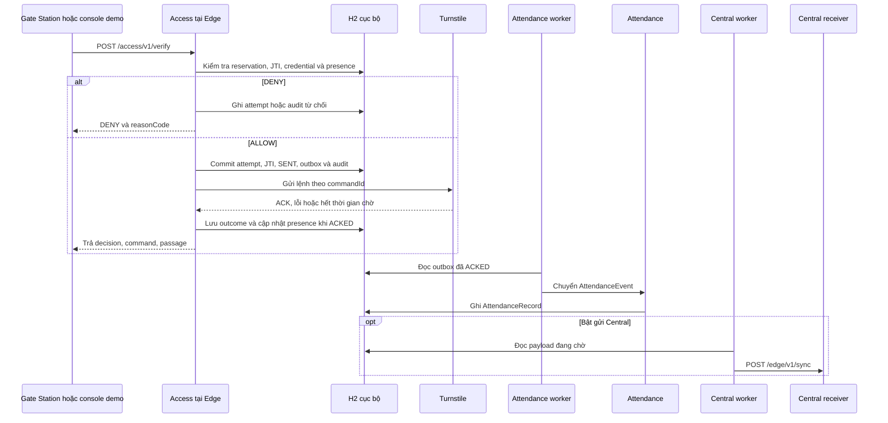

# Kiến trúc hiện thực Phase 2

Access chạy trên Edge Agent. Gate Station gọi Edge tại site. Edge dùng H2 cục bộ để quyết định và ghi nhận sự kiện, sau đó xử lý đồng bộ với Attendance và Central qua outbox. Console React đóng vai Gate Station khi demo.

Thiết kế gốc, các phương án đã so sánh, ADR và các giả định Phase 0–1 nằm trong [Phase1_Architecture.md](../Phase1_Architecture.md). Tài liệu này mô tả các package và hành vi hiện có trong repo.

## 1. Module view

Backend dùng **modular monolith**. Mỗi đơn vị triển khai có một ứng dụng Spring Boot với các module nghiệp vụ tách theo package. Trong Access, API gọi application. Application điều phối các bước và gọi port. Adapter thực hiện port ở lớp infrastructure. `tmc.bootstrap` ghép các thành phần và chạy worker.

| Package | Chức năng và quyền sở hữu |
| --- | --- |
| [`tmc.access`](../backend/src/main/java/tmc/access/) | Check-in/out, xác minh QR, idempotency, anti-passback, điều khiển cổng và ghi nhận passage. Access sở hữu `AccessAttempt`, used JTI, reservation, presence và edge outbox. |
| [`tmc.userqr`](../backend/src/main/java/tmc/userqr/) | Cấp QR ES256 ngắn hạn và thu hồi credential. Hai use case dùng các port credential và token được chia sẻ từ Access. |
| [`tmc.attendance`](../backend/src/main/java/tmc/attendance/) | Nhận `AttendanceEvent`, áp dụng `EligibilityPolicy` và quản lý bảng `attendance_record`. Cung cấp tra cứu có scope và CSV tháng. |
| [`tmc.sync`](../backend/src/main/java/tmc/sync/) | API nhận batch ở Central và bộ nhận demo chống trùng theo `eventId`, đánh dấu `SUSPICIOUS` khi JTI xuất hiện ở hai site. |
| [`tmc.shared`](../backend/src/main/java/tmc/shared/) | Clock, ID, audit, correlation ID và contract outbox dùng chung. `EdgeSyncEvent` là DTO giao tiếp giữa Edge và Central. |
| [`tmc.bootstrap`](../backend/src/main/java/tmc/bootstrap/) | Composition root, cấu hình Spring, worker và mapping giữa Access và Attendance. |

```text
backend/src/main/java/tmc/
├── access/
│   ├── api/                  REST verify, passage và correction
│   ├── application/          Use case, pipeline, step và policy/scope ports
│   ├── domain/               Aggregate, trạng thái, value object và ports
│   └── infrastructure/
│       ├── persistence/      JDBC, in-memory stores và codec outbox
│       ├── security/         ES256, xác thực trạm và quyền demo
│       ├── snapshot/         Snapshot dạng file và in-memory
│       └── turnstile/        Fake, simulator, HTTP skeleton, timeout và metrics
├── userqr/                   API và use case cấp/thu hồi QR
├── attendance/               API, application, domain, contract và stores
├── sync/                     Central API và bộ nhận demo
├── shared/                   Audit, clock, ID, outbox contract và filter HTTP
└── bootstrap/
    ├── mapping/              Chuyển AccessAttempt thành AttendanceEvent
    └── worker/               Attendance, Central sync, đối soát, snapshot và HR
```

`backend/src/main/resources/schema.sql` đặt các bảng trong cùng DB của demo. Quyền sở hữu bảng đi theo module. Attendance ghi bảng của mình từ event contract và không truy vấn bảng `access_attempt`. Worker đọc qua adapter của Access ở composition root. Access, UserQr, Attendance, Sync và Shared được kiểm tra không tạo vòng phụ thuộc bằng [ArchUnit](../backend/src/test/java/tmc/architecture/ArchitectureRulesTest.java). Các điểm chưa tách hoàn toàn theo contract được ghi trong [checklist](solid-and-traceability.md).

## 2. Component-and-connector view



### Xử lý lỗi và dữ liệu

- **Scan và retry.** Edge xác thực trạm, kiểm tra scope rồi tra idempotency. Retry cùng `eventId` và cùng fingerprint có thể nhận `409 REQUEST_IN_PROGRESS` hoặc kết quả đã lưu. Một JTI được dùng một lần trong mỗi site. Central phát hiện dùng lại giữa site sau khi đồng bộ.
- **Giao dịch trước lệnh cổng.** Nếu transaction ghi `SENT` lỗi, Edge từ chối, JTI được rollback và lệnh chưa được gửi. Sau khi gửi, timeout tạo `UNKNOWN`. Worker truy vấn trạng thái theo ID thay cho việc gửi lại lệnh.
- **Ba trạng thái độc lập.** `decision` là kết quả kiểm tra quyền. `command` là trạng thái lệnh điều khiển. `passage` là trạng thái chứng cứ qua cổng. ACK tạo `ACK_ONLY` và cập nhật presence. Chứng cứ riêng mới tạo `CONFIRMED`. `NOT_AVAILABLE` nghĩa là chưa cấu hình nguồn cảm biến, còn `UNCONFIRMED` nghĩa là đang chờ chứng cứ.
- **Chấm công.** Worker chỉ đưa ACKED vào attendance. `ACK_ONLY` bật cờ rà soát HR. UNKNOWN ở luồng đối soát; FAILED bị loại khỏi xuất công. Guard demo có thể sửa quên quét ra với audit mà không sinh scan chấm công mới.
- **Mất WAN.** Đường verify dùng dữ liệu cục bộ. Khi chạy với snapshot, Edge fail-closed nếu snapshot stale. Thu hồi trong cửa sổ staleness vẫn có thể chưa được Edge biết. Báo động JTI khác site chỉ xuất hiện sau sync.

## 3. Allocation view

| Thành phần | Chạy trong demo | Mô hình triển khai thiết kế |
| --- | --- | --- |
| Console | Dev server Vite hoặc frontend build trên máy demo | Gate Station hoặc máy vận hành gọi Edge tại site của mình. |
| Edge, H2 và worker | Một process Java hoặc một container trên loopback | Một Edge Agent cho mỗi nhà máy, có DB cục bộ và LAN đến Turnstile. |
| Central receiver | API và receiver in-memory có thể chạy cùng ứng dụng demo | Tiến trình Central phía trung tâm nhận sự kiện qua WAN. |
| Turnstile và HR | Fake Turnstile, CSV và ACK HR mô phỏng | Hai tích hợp thật cần API contract, auth và kiểm thử nghiệm thu. |

Ba view trong tài liệu thiết kế dùng để đánh giá topology khi triển khai. Bản demo có thể chạy trên một máy để chấm Task 2. [Runbook backend](../backend/README.md) · [Frontend](../frontend/README.md)
